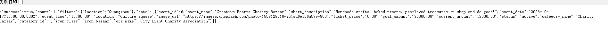
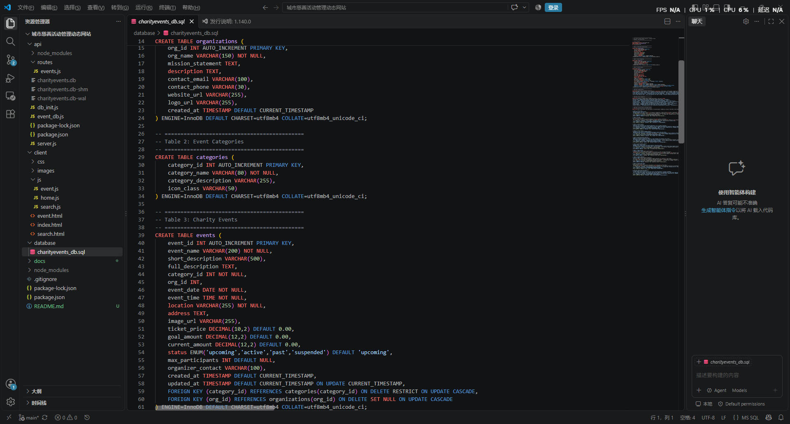
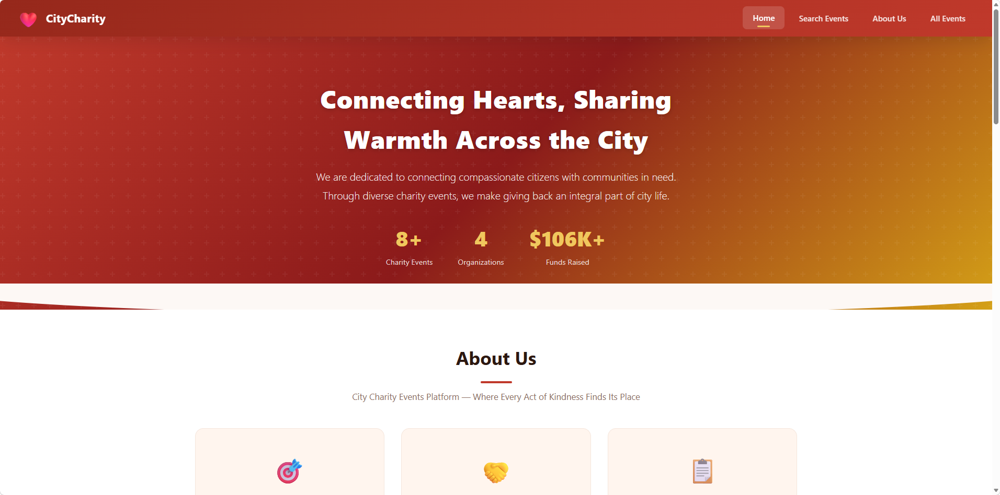
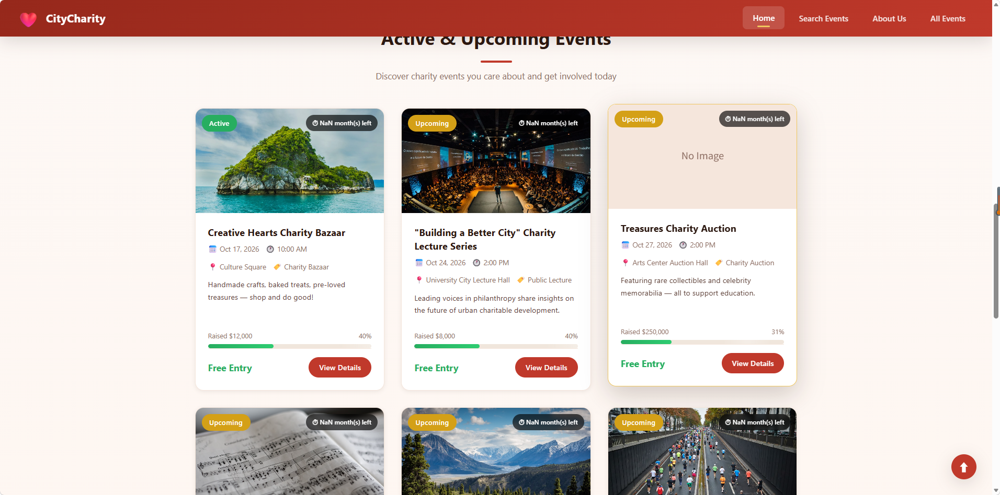
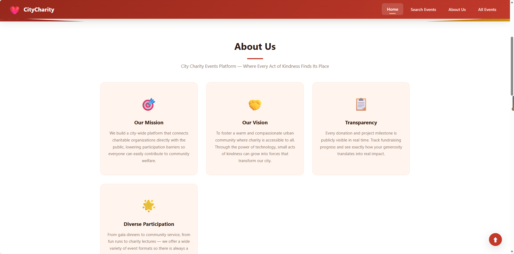
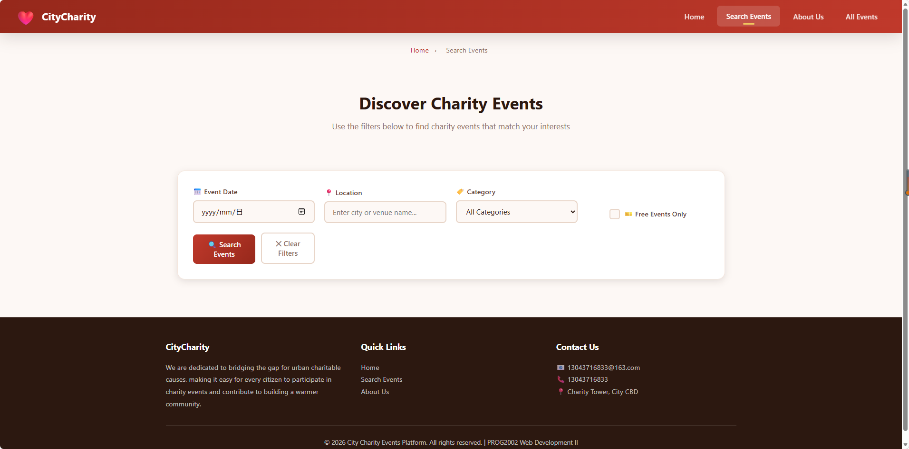
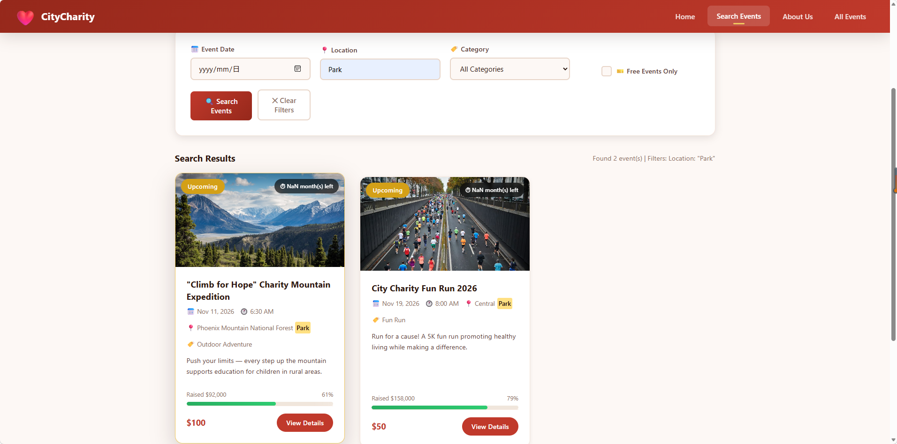
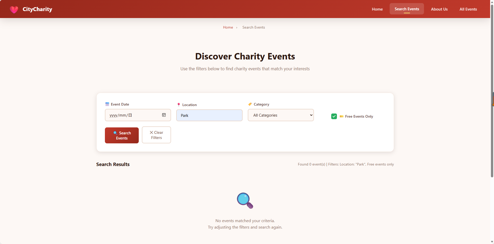
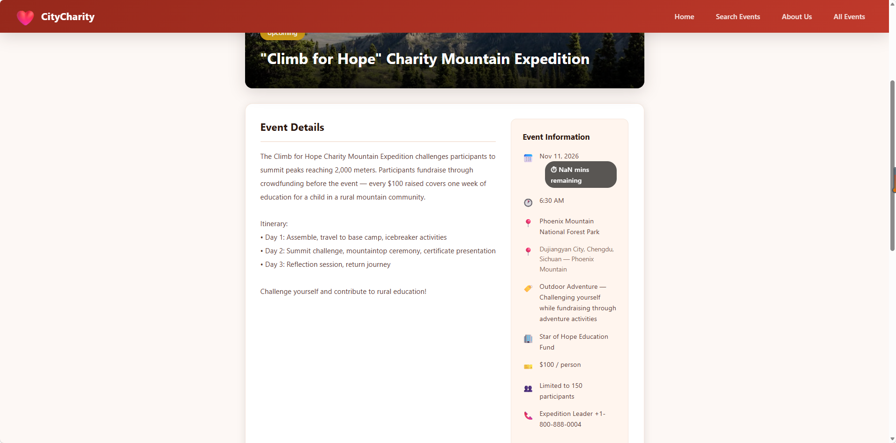
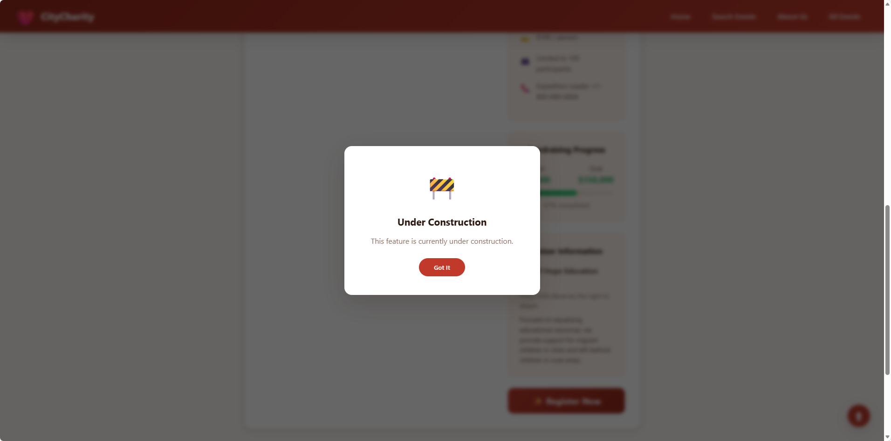

# City Charity Events Platform

**A three-tier dynamic web system — MySQL · Node.js/Express REST API · two Angular 22 applications · Open-Meteo weather integration**

> One MySQL schema, one REST contract, three independently deployable applications.
>
> **English** · [中文完整版 / Chinese version](#城市慈善活动管理平台)

[](https://angular.dev/)
[](https://www.typescriptlang.org/)
[](https://nodejs.org/)
[](https://expressjs.com/)
[](https://www.mysql.com/)
[](https://restfulapi.net/)

---

## Table of Contents

- [1. Overview](#1-overview)
- [2. Deployment](#2-deployment)
- [3. Feature Summary](#3-feature-summary)
- [4. Architecture](#4-architecture)
- [5. Technology Stack](#5-technology-stack)
- [6. Database Design](#6-database-design)
- [7. API Reference](#7-api-reference)
- [8. Frontend Architecture](#8-frontend-architecture)
- [9. Weather Integration](#9-weather-integration)
- [10. Engineering Challenges](#10-engineering-challenges)
- [11. Getting Started](#11-getting-started)
- [12. Configuration](#12-configuration)
- [13. Deployment to cPanel](#13-deployment-to-cpanel)
- [14. Project Structure](#14-project-structure)
- [15. Manual Test Checklist](#15-manual-test-checklist)
- [16. Limitations and Roadmap](#16-limitations-and-roadmap)
- [17. Visual walkthrough](#17-visual-walkthrough)
- [中文版 / Chinese version](#城市慈善活动管理平台)
- [Author](#author--作者)

---

## 1. Overview

The **City Charity Events Platform** connects charitable organisations with the public and gives staff the tools to manage the catalogue behind it. It is delivered as **three independently deployable applications** sharing one REST contract and one relational database:

| Application | Stack | Dev port | Responsibility |
|---|---|---|---|
| **`clientside/`** — public website | Angular 22 + TypeScript | 4200 | Browse, search, inspect and register for events |
| **`adminside/`** — staff console | Angular 22 + TypeScript | 4300 | Full C.R.U.D. over events, registration oversight |
| **`api/`** — REST service | Node.js + Express + MySQL | 3000 | Data access, business rules, weather proxy |

Every figure, list and confirmation on screen is retrieved from MySQL through the API. Nothing is hard-coded, and the two front ends contain no database access of their own.

---

## 2. Deployment

All three applications are served from a single origin. Paths are listed rather than host names, so the repository stays deployment-agnostic.

| Application | Path | Served from |
|---|---|---|
| Public website | `/` | `public_html` (static build) |
| Admin console | `/admin/` | `public_html/admin` (static build, `--base-href /admin/`) |
| REST API | `/api` | Node.js application (*Setup Node.js App*) |
| Health probe | `/api/health` | Node.js application |

> **HTTPS note:** the host serving this build must present a certificate covering the exact host name in use. A certificate issued for the parent domain only — without a wildcard SAN — makes browsers abort the handshake with `ERR_SSL_VERSION_OR_CIPHER_MISMATCH`, even though the files and the database would be perfectly reachable once TLS is fixed. Check the certificate before assuming the deployment failed.

All three run under one shared-hosting account: the API is a Node.js application whose base URI is `/api`, and the two Angular builds are uploaded as static files to `public_html` and `public_html/admin`. See [Section 13](#13-deployment-to-cpanel).

---

## 3. Feature Summary

### Public website

| Area | Capability |
|---|---|
| Home | Live event grid with status badges, countdowns and fundraising progress; headline statistics computed from the API |
| Search | Freely combinable filters: date, location (fuzzy), category, free-only; matched term highlighted; explicit empty state |
| Event detail | Full record, organiser profile, capacity and fundraising progress, **registration list**, seven-day venue forecast |
| Registration | Dedicated page, validated reactive form, ticket quantity, confirmation receipt, capacity and duplicate checks |

### Admin console

| Area | Capability |
|---|---|
| Dashboard | Headline figures, status and category mix, latest registrations, fundraising leaderboard |
| List | Every event regardless of status, with registration and ticket counts; seven sortable columns; independent text/status/category filters; one-click reset |
| Create | Validated form covering all required fields, posting to `POST /api/events` |
| Edit | Same form plus that event's registrations, saving through `PUT /api/events/:id` |
| Delete | Blocked with **HTTP 409** when registrations exist; the dialog renders the server's counts verbatim |
| Suspend / reinstate | Single control that immediately publishes or hides an event |
| CSV export | Exports exactly the rows currently on screen, respecting active filters |
| Navigation | Persistent header menu on every page, accurate active state, shortcut to the public site |
| Guard | Route guard refuses to discard a half-completed form |

### API

Full C.R.U.D. over events, registration creation and listing, organisation lookup, and a translated weather proxy — with uniform response envelopes and deliberate HTTP status codes.

---

## 4. Architecture

```
┌──────────────────────────┐        ┌──────────────────────────┐
│  clientside/  :4200      │        │  adminside/   :4300      │
│  Angular 22 + TypeScript │        │  Angular 22 + TypeScript │
│  home · search · detail  │        │  dashboard · list · form │
│  registration · weather  │        │  delete · registrations  │
└────────────┬─────────────┘        └────────────┬─────────────┘
             │  HttpClient (typed)               │
             │  /api proxied in dev              │
             └───────────────┬───────────────────┘
                             │  HTTP / JSON
             ┌───────────────▼───────────────────────────────┐
             │            api/  :3000  (Express)             │
             │  cors · json · routes                         │
             │  ├── /api/events          read + CRUD         │
             │  ├── /api/registrations   create + list       │
             │  ├── /api/organizations   read                │
             │  └── /api/weather         Open-Meteo proxy    │
             └───────────────┬───────────────────────────────┘
                             │  mysql2 pool (10, keep-alive)
             ┌───────────────▼───────────────────────────────┐
             │        MySQL 8  ·  charityevents_db           │
             │  organizations ─┐                             │
             │                 ├── events ──> categories     │
             │  registrations ─┘  (FKs, ENUM, indexes)       │
             └───────────────────────────────────────────────┘
                             │
                    ┌────────▼─────────┐
                    │  Open-Meteo API  │  (server-to-server)
                    └──────────────────┘
```

**Why two front ends rather than one SPA with an `/admin` section?** The public site and the staff console are separate Angular projects with separate bundles, design systems and deployment targets; they share only the REST contract and the TypeScript domain models. The boundary is enforced by build topology, not by conditional rendering — the admin bundle never ships public-site code, and the public bundle contains no concept of delete or update at all.

**Request lifecycle — registering for an event**

1. `/events/1` → `EventDetail` reads the route parameter through `withComponentInputBinding()`
2. `EventService.getEventById(1)` → `GET /api/events/1`
3. The API runs the event query and a second query for registrations ordered `registration_date DESC`
4. The API computes `tickets_sold`, `tickets_remaining` and `progress_percentage` server-side
5. Angular renders the page and passes `latitude`/`longitude` to `WeatherWidget`
6. `WeatherWidget` → `GET /api/weather` → Express proxies Open-Meteo → translated forecast
7. **Register now** → `/events/1/register`
8. The reactive form validates, then `POST /api/registrations`
9. The API validates, checks status and remaining capacity, inserts, returns **201**
10. The form is replaced by a confirmation receipt

---

## 5. Technology Stack

### Front end (both applications)

| Technology | Version | Role |
|---|---|---|
| Angular | 22.2 | Standalone components, signals, lazy routes, zoneless change detection |
| TypeScript | 6.0 | Strict typing end to end; domain models shared across services |
| Reactive Forms | Angular 22 | Validation with `Validators`, form values bridged to signals |
| `HttpClient` + `withFetch` | Angular 22 | Typed services returning `Observable<T>` |
| CSS3 | — | Two hand-built design systems (public warm, admin neutral) |

No component library, no Tailwind, no state-management library.

### Back end

| Technology | Version | Role |
|---|---|---|
| Node.js | ≥ 24.15 (CLI requirement) | Runtime |
| Express | 4.18 | Routing, middleware, JSON handling |
| mysql2 | 3.6 | Promise API, connection pool, `dateStrings` |
| cors | 2.8 | Cross-origin access for split-origin deployment |
| dotenv | 16.3 | Local `.env` loading (absent in production) |

### Data and external services

| Technology | Role |
|---|---|
| MySQL 8.x | InnoDB, `utf8mb4`, foreign keys with intentional actions, `ENUM`, `CHECK`, `UNIQUE`, indexes |
| Open-Meteo | Public forecast API, consumed server-side only |

---

## 6. Database Design

Four tables in **third normal form**, with `events` as the central fact table and `registrations` as the transactional detail table.

```
┌────────────────────┐        ┌─────────────────────┐
│   organizations    │        │     categories      │
├────────────────────┤        ├─────────────────────┤
│ org_id        PK   │        │ category_id    PK   │
│ org_name           │        │ category_name       │
│ mission_statement  │        │ category_description│
│ description        │        │ icon_class          │
│ contact_*          │        └──────────┬──────────┘
│ website_url        │                   │ ON DELETE RESTRICT
└─────────┬──────────┘                   │
          │ ON DELETE SET NULL           │
     ┌────▼──────────────────────────────▼──────┐
     │                 events                    │
     ├───────────────────────────────────────────┤
     │ event_id            PK                    │
     │ event_name · short_description            │
     │ full_description                          │
     │ category_id         FK → categories       │
     │ org_id              FK → organizations    │
     │ event_date · event_time                   │
     │ location · address                        │
     │ latitude · longitude    ← weather         │
     │ image_url                                 │
     │ ticket_price · goal_amount · current_amount│
     │ status ENUM(upcoming|active|past|suspended)│
     │ max_participants · organizer_contact       │
     │ created_at · updated_at                    │
     │ INDEX (status) (event_date) (category_id)  │
     └───────────────────┬───────────────────────┘
                         │ ON DELETE RESTRICT
     ┌───────────────────▼───────────────────────┐
     │              registrations                 │
     ├────────────────────────────────────────────┤
     │ registration_id      PK                    │
     │ event_id             FK → events           │
     │ attendee_name                              │
     │ attendee_email                             │
     │ attendee_phone                             │
     │ tickets_purchased    CHECK > 0             │
     │ registration_date    DEFAULT CURRENT_TIMESTAMP │
     │ special_requests                           │
     │ UNIQUE (event_id, attendee_email)          │
     │ INDEX (event_id) (registration_date)       │
     └────────────────────────────────────────────┘
```

### Constraint rationale

| Decision | Justification |
|---|---|
| 3NF normalisation | An organisation's contact details exist in exactly one row — no update anomalies |
| `ENUM` for `status` | The lifecycle vocabulary is enforced by the database; invalid states are unrepresentable |
| `DECIMAL(12,2)` for money | Exact decimal arithmetic; floating point would corrupt fundraising totals |
| `UNIQUE (event_id, attendee_email)` | Implements "one registration per person per event" as a hard guarantee, not a hope |
| `CHECK (tickets_purchased > 0)` | Rejects nonsensical quantities beneath the API layer |
| `ON DELETE RESTRICT` on registrations | Protects attendee records; makes the 409 rule structural |
| `ON DELETE SET NULL` on organisations | An organisation may leave; its events survive unassigned |
| Indexes on `status`, `event_date`, `category_id` | Exactly the columns used by filters and sort order |
| `latitude` / `longitude` | Required by Open-Meteo to produce a venue forecast |

**Seed dataset:** 4 organisations · 8 categories · 10 events · **13 registrations** across 6 events. Events 5, 7, 9 and 10 deliberately have **no** registrations so the delete flow can be demonstrated both blocked (409) and successful.

The complete schema **and** data live in one importable file: `database/charityevents_db.sql`.

---

## 7. API Reference

Base URL (development): `http://localhost:3000/api`
Base URL (deployed): `https://<your-domain>/api` — same-origin deployment, so both front ends keep using the relative `/api`.

### Events

| Method | Endpoint | Purpose |
|---|---|---|
| `GET` | `/api` | Service discovery / endpoint index |
| `GET` | `/api/health` | Database health probe |
| `GET` | `/api/events` | Upcoming + active events (public home) |
| `GET` | `/api/events/search` | Combinable filtering (public search) |
| `GET` | `/api/events/categories/list` | Categories with live event counts |
| `GET` | `/api/events/admin/all` | **Every** event, all statuses, with registration counts |
| `GET` | `/api/events/:id` | Full detail **including its registration list** |
| `POST` | `/api/events` | Create an event |
| `PUT` | `/api/events/:id` | Update an event (full or partial payload) |
| `DELETE` | `/api/events/:id` | Delete — **409 if registrations exist** |

> Route order matters: `/admin/all`, `/search` and `/categories/list` are declared before `/:id`, otherwise Express would read those words as event identifiers.

### Registrations, organisations, weather

| Method | Endpoint | Purpose |
|---|---|---|
| `GET` | `/api/registrations?eventId=3` | List registrations, optionally scoped to one event |
| `POST` | `/api/registrations` | Create a registration (ticket purchase) |
| `GET` | `/api/organizations` | Organisations for the admin dropdown |
| `GET` | `/api/weather?lat=&lon=&timezone=` | Translated Open-Meteo forecast |
| `GET` | `/api/weather/codes` | WMO code → description/icon legend |

### Search parameters

| Param | Type | Behaviour |
|---|---|---|
| `date` | `YYYY-MM-DD` | Exact date match |
| `location` | string | **Fuzzy** — `LIKE %…%` against both `location` and `address` |
| `category` | int | Exact category id |
| `freeOnly` | `1` | Only `ticket_price = 0` or `NULL` |

All optional and freely combinable.

### Status codes

| Code | Meaning |
|---|---|
| `200` | Success |
| `201` | Resource created |
| `400` | Validation failure (with an `errors[]` array) |
| `404` | Unknown event |
| `409` | Business rule conflict — duplicate registration, full capacity, or event has registrations |
| `500` | Unexpected server fault |
| `502` / `504` | Upstream weather service failure / timeout |

### Response envelope

```json
{ "success": true, "count": 3, "data": [ ... ] }
{ "success": false, "message": "Validation failed", "errors": ["Email is required"] }
```

### Implementation notes

**Search is assembled, not concatenated.** One statement is built at run time while every user value stays in a bound parameter array:

```js
if (date)     { sql += ' AND e.event_date = ?';            params.push(date); }
if (location) { sql += ' AND (e.location LIKE ? OR e.address LIKE ?)';
                params.push(`%${location}%`, `%${location}%`); }
if (category) { sql += ' AND c.category_id = ?';           params.push(parseInt(category, 10)); }
if (freeOnly) { sql += ' AND (e.ticket_price = 0 OR e.ticket_price IS NULL)'; }

const [rows] = await pool.execute(sql, params);   // prepared statement
```

**Deletion enforces integrity twice.** The API counts registrations and tickets before deleting and refuses with 409, returning both figures. The foreign key is `ON DELETE RESTRICT`, so MySQL refuses too if a registration arrived in between — that error is translated into the same 409.

**Detail pages cost two round trips,** not one query per row: one joined event query plus one registration query, with aggregates computed server-side so both front ends show identical numbers.

---

## 8. Frontend Architecture

Both applications follow the same shape:

```
src/app/
├── app.ts / app.html            # shell: navbar + router-outlet + footer
├── app.config.ts                # providers: router, HttpClient, scrolling
├── app.routes.ts                # lazy loadComponent per screen
├── core/
│   ├── config/api.config.ts     # single API base + public site URL
│   ├── models/*.ts              # typed contract with the API
│   └── services/*.ts            # HTTP + error normalisation
├── shared/                      # reusable presentation
└── pages/                       # one folder per screen
```

**Angular 22 features used deliberately**

| Feature | Where it matters |
|---|---|
| **Signals** (`signal`, `computed`, `input`) | Every component holds state as signals, so zoneless change detection works without `markForCheck` |
| **Standalone components** | No `NgModule` anywhere; each component declares exactly what it imports |
| **Lazy `loadComponent`** | Only the shell and the current screen are downloaded |
| **`withComponentInputBinding()`** | `/events/:id` binds straight into `readonly id = input.required<string>()` |
| **Reactive Forms** | Validation on registration and admin forms, with live value signals |
| **Typed HTTP services** | Components never touch `HttpClient`; they receive `Observable<CharityEvent>` |
| **`takeUntilDestroyed`** | Weather subscriptions cannot outlive their component |

Error handling is centralised per application in `extractApiError()`, which prefers field-level `errors[]`, then `message`, and falls back to a network hint when `status === 0`.

**Public routes**

| Route | Screen |
|---|---|
| `/` | Home — hero, live statistics, event grid |
| `/search` | Search — four combinable filters |
| `/events/:id` | Detail — record, organiser, progress, registrations, weather |
| `/events/:id/register` | Registration — validated form + confirmation |

**Admin routes**

| Route | Screen |
|---|---|
| `/` | Dashboard — KPIs, status and category mix, recent registrations, fundraising |
| `/events` | Event list — stats, search, filters, sorting, CSV, suspend, edit/delete |
| `/events/new` | Create form |
| `/events/:id/edit` | Edit form + that event's registrations |

Both form routes carry `canDeactivate: [unsavedChangesGuard]`, so leaving a half-filled form asks for confirmation instead of silently discarding the edits.

---

## 9. Weather Integration

```
Angular WeatherWidget
        │  GET /api/weather?lat=39.9087&lon=116.4576&timezone=Asia/Shanghai
        ▼
Express /api/weather
        │  · validates lat/lon ranges
        │  · 10-minute in-memory cache
        │  · 8-second AbortController timeout
        │  · translates WMO codes → description + icon + group
        ▼
https://api.open-meteo.com/v1/forecast
```

The browser never calls Open-Meteo directly, which means:

1. **No third-party CORS dependency** — our origin is the only one that matters
2. **One translation table** — both applications render identical wording for code `95`
3. **Caching** — ten page views do not become ten upstream requests
4. **Timeout control** — a slow third party cannot hang the UI indefinitely
5. **Swap-friendly** — replacing the provider changes one file, not every component

The widget degrades gracefully: no coordinates → neutral notice; upstream failure → the error text; during load → a placeholder.

---

## 10. Engineering Challenges

**A cross-tier timezone defect.** Every event rendered one day early and countdowns printed `NaN month(s) left`, with no console error. `mysql2` was converting a MySQL `DATE` into a JavaScript `Date` at local midnight, which `JSON.stringify` serialised as a UTC instant one day behind. Fixed at the source (`dateStrings: true`) and defended on the client (slice to 10 characters, guard `isNaN`).

**Duplicate registrations under concurrency.** A read-then-insert check races: two requests can both read "not registered". The guarantee lives in the schema as `UNIQUE (event_id, attendee_email)`; the API still pre-checks for a friendly message and translates `ER_DUP_ENTRY` into 409.

**Deleting an event without destroying attendance history.** `ON DELETE CASCADE` would silently erase registrations. `ON DELETE RESTRICT` plus an explicit pre-flight count keeps the history intact and turns the refusal into an informative response.

**Two SPAs over one API.** Each Angular project ships a `proxy.conf.json` mapping `/api` → `:3000`, so application code uses the relative base `/api` and knows no hostnames; the API enables `cors()` as a fallback for split-origin deployment.

**N+1 queries on the detail page.** One `JOIN`ed event query plus one registration query — a constant two round trips — with aggregates computed once on the server.

**Zoneless change detection with reactive forms.** All mutable state is a signal; derived values are `computed()`; form values that drive the UI are bridged with `toSignal(form.valueChanges)`.

---

## 11. Getting Started

### Prerequisites

- **Node.js** — the Angular 22 CLI accepts `v24.15.0+`, `v22.22.3+` or `v26.0.0+`
- **MySQL 8.x** running locally
- **npm 11+**

### Clone

```bash
git clone https://github.com/WangYuning111/City-Charity-Events-Platform.git
cd City-Charity-Events-Platform
```

### 1 · Create and seed the database

```bash
mysql -u root -p < database/charityevents_db.sql
```

This creates `charityevents_db` with all four tables and seeds 10 events / 13 registrations. The file is BOM-free and safe to re-run.

### 2 · Start the API

```bash
cd api
npm install
cp .env.example .env     # optional locally: defaults already match root / empty password
node server.js
```

Expected output — the connection probe from `event_db.js`, then the server banner from `server.js`:

```
MySQL database connected successfully!
  Events: 10 | Categories: 8
========================================
  City Charity Events - API Server
========================================
  API:       http://localhost:3000/api
  Client:    http://localhost:4200  (ng serve clientside)
  Admin:     http://localhost:4300  (ng serve adminside)
========================================
```

### 3 · Start the public website

```bash
cd clientside
npm install
npm start          # ng serve → http://localhost:4200
```

### 4 · Start the admin console

```bash
cd adminside
npm install
npm start          # ng serve → http://localhost:4300
```

| Service | URL |
|---|---|
| Public website | http://localhost:4200 |
| Admin console | http://localhost:4300 |
| API | http://localhost:3000/api |

### Optional — running without MySQL

```bash
cd api && npm install --no-save better-sqlite3 && node db_init.js
```

`db_init.js` builds a standalone SQLite database for an offline demo. It is an optional convenience; the application itself always talks to MySQL.

---

## 12. Configuration

### Database credentials — environment variables

`api/event_db.js` reads its settings from the environment and falls back to local defaults:

| Variable | Local default | cPanel value |
|---|---|---|
| `DB_HOST` | `localhost` | `127.0.0.1` |
| `DB_PORT` | `3306` | `3306` |
| `DB_USER` | `root` | `<account>_<user>` |
| `DB_PASSWORD` | *(empty)* | the MySQL user's password |
| `DB_NAME` | `charityevents_db` | `<account>_<database>` |

Locally, put them in a git-ignored `api/.env` (template: `api/.env.example`). In production they are set in the cPanel Node.js application panel.

### Front-end API base

```ts
// clientside/src/app/core/config/api.config.ts
export const API_BASE = '/api';
```

A relative path works in development (through `proxy.conf.json`) and in production (API on the same origin). Only a split-origin deployment needs an absolute URL.

```ts
// adminside/src/app/core/config/api.config.ts
export const PUBLIC_SITE_URL = 'http://localhost:4200';
```

Used by the "view public site" shortcut and the per-row link to the public page. It defaults to the dev server, so no deployed host name lives in the source; point it at the production origin before a release build.

---

## 13. Deployment to cPanel

Everything is served from one account, so `API_BASE` stays relative and there is no CORS to configure.

| URL | Serves | Uploaded from |
|---|---|---|
| `/` | public website | `dist/clientside/browser` |
| `/admin/` | admin console | `dist/adminside/browser` (built with `--base-href /admin/`) |
| `/api/...` | REST API | `api/` through *Setup Node.js App* |

### Build

```bash
cd clientside && npm run build                                  # → dist/clientside/browser
cd ../adminside && npm run build -- --base-href /admin/          # → dist/adminside/browser
```

### Database

Create the database and a user in *MySQL Databases*, grant ALL PRIVILEGES, then import **`database/charityevents_cpanel.sql`** through phpMyAdmin. Use that copy, not the original: a hosting user has no `CREATE DATABASE` privilege, so the `DROP DATABASE` / `CREATE DATABASE` statements abort the import.

### API

1. Upload `api/` (without `node_modules/` or `*.db`) to a directory **outside** `public_html`, e.g. `~/charity_api`.
2. *Setup Node.js App* → Create: application root `charity_api`, application URL `api`, startup file `server.js`, mode Production.
3. Add `DB_HOST`, `DB_PORT`, `DB_USER`, `DB_PASSWORD`, `DB_NAME` as environment variables — no credential is committed to Git.
4. Run *NPM Install*, then *Restart*; check `/api/health` for `{"success":true,"database":"connected"}`.

> `better-sqlite3` is not a runtime dependency, so nothing native has to compile on the host.

### Front ends

Upload the **contents** of each `dist/*/browser` folder to `public_html/` and `public_html/admin/`.

### Rewrite rules

Copy `deploy/public_html/.htaccess` to `public_html/.htaccess` and `deploy/public_html/admin/.htaccess` to `public_html/admin/.htaccess`. Without them a refresh on `/events/3` or `/admin/events/3/edit` returns 404, and `/api` requests would be swallowed by the SPA rewrite. The root file also disables directory listing and marks `index.html` as non-cacheable.

---

## 14. Project Structure

```
城市慈善活动管理动态网站/
├── api/                          # Express REST service
│   ├── server.js                 # entry point, route mounting
│   ├── event_db.js               # mysql2 pool, env-based config
│   ├── db_init.js                # optional offline SQLite demo
│   ├── .env.example
│   └── routes/
│       ├── events.js             # read + CRUD, 409 integrity rule
│       ├── registrations.js      # create + list
│       ├── organizations.js      # lookup
│       └── weather.js            # Open-Meteo proxy, cache, WMO map
├── clientside/                   # public Angular application
│   └── src/app/{core,pages,shared}
├── adminside/                    # admin Angular application
│   └── src/app/{core,pages,shared}
├── database/
│   ├── charityevents_db.sql      # full schema + seed data
│   └── charityevents_cpanel.sql  # import-ready copy for shared hosting
├── deploy/
│   ├── out/                      # build packages for upload (git-ignored)
│   └── public_html/              # .htaccess files (root + /admin)
├── docs/screenshots/a3/          # documentation captures
└── archive/a2-vanilla-client/    # previous iteration, kept for reference
```

---

## 15. Manual Test Checklist

| Check | Expected |
|---|---|
| `GET /api/health` | `{"success":true,"database":"connected"}` |
| `GET /api/events` | Only `upcoming` / `active` events |
| `GET /api/events/search?location=…` | Fuzzy match on venue and address |
| `GET /api/events/1` | Event plus registrations, newest first |
| `POST /api/registrations` (valid) | 201 with the created record |
| Same email, same event again | 409, no duplicate row |
| `DELETE` an event with registrations | 409 with `registration_count` and `tickets_sold` |
| `DELETE` an event without registrations | 200, row removed |
| Refresh `/events/3` | Page renders (SPA fallback) |
| Refresh `/admin/events/3/edit` | Page renders |
| `GET /api/weather` with valid coordinates | Seven-day forecast |

### Public site in a browser

| Step | Expected |
|---|---|
| Open `/` | Hero, live statistics and the event grid all come from the API |
| Search with location + category + free-only | Filtered count, and an empty state when nothing matches |
| Open an event and register | Confirmation receipt; the remaining-seat count drops on the detail page |
| Register the same email for the same event again | Inline 409 message, no duplicate row |

### Admin console in a browser

| Step | Expected |
|---|---|
| Open `/admin/` | KPIs, status mix and recent registrations |
| Filter, sort and export the event list | Rows, statistics and the CSV agree with the active filters |
| Delete an event that has registrations | Blocked dialog quoting registration and ticket counts |
| Suspend, then reinstate an event | Badge changes in the list and on the public site |

---

## 16. Limitations and Roadmap

- **No admin authentication.** Out of scope here; it is the first change production use would demand (session or JWT, role-based access).
- **No pagination** on the admin list — fine at ten events, a problem at a thousand.
- **Capacity is enforced in the API**, because it is a cross-row aggregate a `CHECK` cannot express; a transactional stored procedure would make it atomic under heavy concurrency.
- **Fixed currency and time zone.**
- **Per-process weather cache** — a second instance would double upstream traffic.

---

## 17. Visual walkthrough

Eighteen captures, all under `docs/screenshots/`. They follow the visitor journey first, then the staff console, then the API and database, and finally the earlier build kept for comparison.

### Visitor journey — final build

| Landing page: hero and live counters | Event grid with status badges and funding progress |
|---|---|
|  |  |

| Search results, matched term highlighted | Event detail: organiser, progress, registrations |
|---|---|
|  |  |

| Registration confirmed |
|---|
|  |

### Staff console — final build

| Dashboard: KPIs, status mix, latest registrations | Event list: filters, sorting, CSV, suspend, edit, delete |
|---|---|
|  |  |

| Delete blocked by the integrity rule (HTTP 409) |
|---|
|  |

### API and database

| Search endpoint exercised in Postman | Schema and seed data in MySQL |
|---|---|
|  |  |

### Earlier build — complete visitor flow

| Landing hero | Event listing |
|---|---|
|  |  |

| About section | Search filters |
|---|---|
|  |  |

| Search results | Empty state |
|---|---|
|  |  |

| Event detail | Registration dialog |
|---|---|
|  |  |

---

# 城市慈善活动管理平台

**一套三层架构的动态网站系统 —— MySQL · Node.js/Express REST 接口 · 两个 Angular 22 应用 · Open-Meteo 天气集成**

> 一个 MySQL 数据库、一套 REST 契约、三个可独立部署的应用。
>
> [中文](#城市慈善活动管理平台) · **English version:** [City Charity Events Platform](#city-charity-events-platform)

---

## 目录（中文版）

- [1. 项目概览](#1-项目概览)
- [2. 部署地址](#2-部署地址)
- [3. 功能总览](#3-功能总览)
- [4. 系统架构](#4-系统架构)
- [5. 技术栈](#5-技术栈)
- [6. 数据库设计](#6-数据库设计)
- [7. 接口文档](#7-接口文档)
- [8. 前端架构](#8-前端架构)
- [9. 天气集成](#9-天气集成)
- [10. 工程难点](#10-工程难点)
- [11. 本地运行](#11-本地运行)
- [12. 配置说明](#12-配置说明)
- [13. cPanel 部署](#13-cpanel-部署)
- [14. 项目结构](#14-项目结构)
- [15. 人工测试清单](#15-人工测试清单)
- [16. 局限与后续规划](#16-局限与后续规划)
- [17. 界面演示](#17-界面演示)

---

## 1. 项目概览

**城市慈善活动管理平台**在慈善机构与公众之间建立连接，同时为工作人员提供维护活动目录的后台工具。系统以**三个可独立部署的应用**交付，三者共享同一套 REST 契约与同一个关系型数据库：

| 应用 | 技术栈 | 开发端口 | 职责 |
|---|---|---|---|
| **`clientside/`** —— 公众站 | Angular 22 + TypeScript | 4200 | 浏览、搜索、查看活动详情并报名 |
| **`adminside/`** —— 后台管理 | Angular 22 + TypeScript | 4300 | 活动的完整 C.R.U.D.，报名数据管理 |
| **`api/`** —— REST 服务 | Node.js + Express + MySQL | 3000 | 数据访问、业务规则、天气代理 |

页面上每一个数字、列表与确认信息，都是通过 API 从 MySQL 取回的。没有任何硬编码数据，两个前端自身也不包含任何数据库访问代码。

---

## 2. 部署地址

三个应用同源提供。这里只列路径而不写具体域名，让仓库与部署环境解耦。

| 应用 | 路径 | 由什么提供 |
|---|---|---|
| 公众站 | `/` | `public_html`（静态构建） |
| 后台管理 | `/admin/` | `public_html/admin`（静态构建，`--base-href /admin/`） |
| REST 接口 | `/api` | Node.js 应用（*Setup Node.js App*） |
| 健康检查 | `/api/health` | Node.js 应用 |

> **HTTPS 说明：** 承载本次构建的主机必须提供覆盖**所用确切主机名**的证书。若证书只签给父域、且不含通配符 SAN，浏览器会在握手阶段直接报 `ERR_SSL_VERSION_OR_CIPHER_MISMATCH` —— 而此时文件与数据库本身完全正常，TLS 修好后即可访问。在判断部署失败之前，请先确认证书。

三个应用运行在同一个虚拟主机账号下：API 是一个 Node.js 应用，基础 URI 为 `/api`；两个 Angular 构建产物以静态文件形式分别上传到 `public_html` 与 `public_html/admin`。详见 [第 13 节](#13-cpanel-部署)。

---

## 3. 功能总览

### 公众站

| 模块 | 能力 |
|---|---|
| 首页 | 实时活动列表，带状态标签、倒计时与筹款进度；统计数字由 API 计算 |
| 搜索 | 可自由组合的筛选条件：日期、地点（模糊匹配）、类别、仅免费；命中词高亮；明确的空结果状态 |
| 活动详情 | 完整信息、主办机构档案、名额与筹款进度、**报名名单**、场地未来七天天气 |
| 报名 | 独立页面、响应式表单校验、票数选择、报名成功回执、名额与重复报名校验 |

### 后台管理

| 模块 | 能力 |
|---|---|
| 仪表盘 | 关键指标、状态与类别分布、最新报名、筹款排行 |
| 列表 | 覆盖全部状态的活动，含报名数与票数；七列可排序；文本/状态/类别独立筛选；一键重置 |
| 新建 | 覆盖所有必填字段的校验表单，提交至 `POST /api/events` |
| 编辑 | 同一套表单，附该活动的报名记录，通过 `PUT /api/events/:id` 保存 |
| 删除 | 存在报名时以 **HTTP 409** 拒绝；弹窗原样展示服务端返回的数量 |
| 停用 / 恢复 | 单个操作即可让活动立即公开或隐藏 |
| CSV 导出 | 只导出当前屏幕上的行，遵循已生效的筛选条件 |
| 导航 | 每页常驻顶部菜单，激活态准确，并提供跳转公众站的快捷入口 |
| 表单守卫 | 路由守卫阻止表单填写一半时被误丢弃 |

### 接口

活动的完整 C.R.U.D.、报名的创建与查询、机构查询，以及一个做了结果翻译的天气代理 —— 统一响应信封，明确区分 HTTP 状态码。

---

## 4. 系统架构

```
┌──────────────────────────┐        ┌──────────────────────────┐
│  clientside/  :4200      │        │  adminside/   :4300      │
│  Angular 22 + TypeScript │        │  Angular 22 + TypeScript │
│  home · search · detail  │        │  dashboard · list · form │
│  registration · weather  │        │  delete · registrations  │
└────────────┬─────────────┘        └────────────┬─────────────┘
             │  HttpClient (typed)               │
             │  /api proxied in dev              │
             └───────────────┬───────────────────┘
                             │  HTTP / JSON
             ┌───────────────▼───────────────────────────────┐
             │            api/  :3000  (Express)             │
             │  cors · json · routes                         │
             │  ├── /api/events          read + CRUD         │
             │  ├── /api/registrations   create + list       │
             │  ├── /api/organizations   read                │
             │  └── /api/weather         Open-Meteo proxy    │
             └───────────────┬───────────────────────────────┘
                             │  mysql2 pool (10, keep-alive)
             ┌───────────────▼───────────────────────────────┐
             │        MySQL 8  ·  charityevents_db           │
             │  organizations ─┐                             │
             │                 ├── events ──> categories     │
             │  registrations ─┘  (FKs, ENUM, indexes)       │
             └───────────────────────────────────────────────┘
                             │
                    ┌────────▼─────────┐
                    │  Open-Meteo API  │  (server-to-server)
                    └──────────────────┘
```

（图中标注的是目录名、表名与端点，保持英文原文以便与代码一一对应。）

**为什么用两个前端，而不是一个 SPA 加 `/admin` 分区？** 公众站与后台是独立的 Angular 工程，各自拥有独立的构建产物、设计系统和部署目标；它们只共享 REST 契约与 TypeScript 领域模型。这条边界由构建拓扑保证，而不是靠条件渲染 —— 后台产物永远不会打包公众站代码，公众站产物里也根本不存在删除与更新这些概念。

**请求链路 —— 报名一个活动**

1. `/events/1` → `EventDetail` 通过 `withComponentInputBinding()` 读取路由参数
2. `EventService.getEventById(1)` → `GET /api/events/1`
3. 接口执行一次活动查询，并再执行一次按 `registration_date DESC` 排序的报名查询
4. 接口在服务端计算 `tickets_sold`、`tickets_remaining` 与 `progress_percentage`
5. Angular 渲染页面，并把 `latitude`/`longitude` 传给 `WeatherWidget`
6. `WeatherWidget` → `GET /api/weather` → Express 代理 Open-Meteo → 返回翻译后的预报
7. 点击 **Register now** → `/events/1/register`
8. 响应式表单校验通过后 → `POST /api/registrations`
9. 接口再次校验、检查状态与剩余名额、写入数据，返回 **201**
10. 表单区域被成功回执替换

---

## 5. 技术栈

### 前端（两个应用相同）

| 技术 | 版本 | 作用 |
|---|---|---|
| Angular | 22.2 | 独立组件、信号、懒加载路由、无 Zone 变更检测 |
| TypeScript | 6.0 | 端到端严格类型；领域模型在服务之间共享 |
| Reactive Forms | Angular 22 | 基于 `Validators` 的校验，表单值桥接为信号 |
| `HttpClient` + `withFetch` | Angular 22 | 返回 `Observable<T>` 的类型化服务 |
| CSS3 | — | 两套手写设计系统（公众站偏暖色，后台偏中性） |

没有使用组件库、Tailwind 或状态管理库。

### 后端

| 技术 | 版本 | 作用 |
|---|---|---|
| Node.js | ≥ 24.15（CLI 要求） | 运行时 |
| Express | 4.18 | 路由、中间件、JSON 处理 |
| mysql2 | 3.6 | Promise API、连接池、`dateStrings` |
| cors | 2.8 | 为分离部署提供跨域访问能力 |
| dotenv | 16.3 | 本地加载 `.env`（生产环境不存在该文件） |

### 数据与外部服务

| 技术 | 作用 |
|---|---|
| MySQL 8.x | InnoDB、`utf8mb4`、带明确删除行为的外键、`ENUM`、`CHECK`、`UNIQUE`、索引 |
| Open-Meteo | 公开天气预报接口，仅在服务端调用 |

---

## 6. 数据库设计

四张表满足**第三范式**，其中 `events` 是核心事实表，`registrations` 是事务明细表。

```
┌────────────────────┐        ┌─────────────────────┐
│   organizations    │        │     categories      │
├────────────────────┤        ├─────────────────────┤
│ org_id        PK   │        │ category_id    PK   │
│ org_name           │        │ category_name       │
│ mission_statement  │        │ category_description│
│ description        │        │ icon_class          │
│ contact_*          │        └──────────┬──────────┘
│ website_url        │                   │ ON DELETE RESTRICT
└─────────┬──────────┘                   │
          │ ON DELETE SET NULL           │
     ┌────▼──────────────────────────────▼──────┐
     │                 events                    │
     ├───────────────────────────────────────────┤
     │ event_id            PK                    │
     │ event_name · short_description            │
     │ full_description                          │
     │ category_id         FK → categories       │
     │ org_id              FK → organizations    │
     │ event_date · event_time                   │
     │ location · address                        │
     │ latitude · longitude    ← weather         │
     │ image_url                                 │
     │ ticket_price · goal_amount · current_amount│
     │ status ENUM(upcoming|active|past|suspended)│
     │ max_participants · organizer_contact       │
     │ created_at · updated_at                    │
     │ INDEX (status) (event_date) (category_id)  │
     └───────────────────┬───────────────────────┘
                         │ ON DELETE RESTRICT
     ┌───────────────────▼───────────────────────┐
     │              registrations                 │
     ├────────────────────────────────────────────┤
     │ registration_id      PK                    │
     │ event_id             FK → events           │
     │ attendee_name                              │
     │ attendee_email                             │
     │ attendee_phone                             │
     │ tickets_purchased    CHECK > 0             │
     │ registration_date    DEFAULT CURRENT_TIMESTAMP │
     │ special_requests                           │
     │ UNIQUE (event_id, attendee_email)          │
     │ INDEX (event_id) (registration_date)       │
     └────────────────────────────────────────────┘
```

### 约束设计理由

| 决策 | 理由 |
|---|---|
| 第三范式 | 同一机构的联系方式只存在一行，不会出现更新异常 |
| `status` 使用 `ENUM` | 生命周期词汇由数据库强制约束，非法状态无法表达 |
| 金额使用 `DECIMAL(12,2)` | 精确小数运算；浮点数会破坏筹款总额 |
| `UNIQUE (event_id, attendee_email)` | 把"每人每活动只能报一次"变成硬性保证，而不是期望 |
| `CHECK (tickets_purchased > 0)` | 在接口层之下再拒绝一次无意义的票数 |
| 报名表使用 `ON DELETE RESTRICT` | 保护报名记录，让 409 规则成为结构上的必然 |
| 机构表使用 `ON DELETE SET NULL` | 机构可以退出，其活动保留为未归属状态 |
| 在 `status`、`event_date`、`category_id` 上建索引 | 正好覆盖筛选与排序用到的列 |
| 保留 `latitude` / `longitude` | Open-Meteo 需要坐标才能给出场地天气 |

**种子数据：** 4 个机构 · 8 个类别 · 10 个活动 · 分布于 6 个活动的 **13 条报名**。活动 5、7、9、10 故意**没有**报名，这样删除流程既能演示被拦截（409），也能演示成功。

完整表结构**与**数据都放在一个可导入的文件里：`database/charityevents_db.sql`。

---

## 7. 接口文档

开发环境基础地址：`http://localhost:3000/api`
部署环境基础地址：`https://<你的域名>/api` —— 同源部署，因此两个前端始终使用相对路径 `/api`。

### 活动

| 方法 | 端点 | 用途 |
|---|---|---|
| `GET` | `/api` | 服务发现 / 端点索引 |
| `GET` | `/api/health` | 数据库健康检查 |
| `GET` | `/api/events` | 即将开始与进行中的活动（公众站首页） |
| `GET` | `/api/events/search` | 可组合筛选（公众站搜索） |
| `GET` | `/api/events/categories/list` | 类别及其当前活动数量 |
| `GET` | `/api/events/admin/all` | **全部**活动、所有状态，附报名数 |
| `GET` | `/api/events/:id` | 完整详情，**包含其报名名单** |
| `POST` | `/api/events` | 新建活动 |
| `PUT` | `/api/events/:id` | 更新活动（全量或部分字段） |
| `DELETE` | `/api/events/:id` | 删除 —— **存在报名时返回 409** |

> 路由顺序很重要：`/admin/all`、`/search`、`/categories/list` 必须声明在 `/:id` 之前，否则 Express 会把这些单词当成活动 id。

### 报名、机构、天气

| 方法 | 端点 | 用途 |
|---|---|---|
| `GET` | `/api/registrations?eventId=3` | 查询报名，可按单个活动过滤 |
| `POST` | `/api/registrations` | 创建报名（购票） |
| `GET` | `/api/organizations` | 供后台下拉框使用的机构列表 |
| `GET` | `/api/weather?lat=&lon=&timezone=` | 翻译后的 Open-Meteo 预报 |
| `GET` | `/api/weather/codes` | WMO 编码 → 描述/图标的对照表 |

### 搜索参数

| 参数 | 类型 | 行为 |
|---|---|---|
| `date` | `YYYY-MM-DD` | 精确匹配日期 |
| `location` | string | **模糊匹配** —— 对 `location` 与 `address` 同时做 `LIKE %…%` |
| `category` | int | 精确匹配类别 id |
| `freeOnly` | `1` | 仅 `ticket_price = 0` 或 `NULL` |

全部可选，可自由组合。

### 状态码

| 状态码 | 含义 |
|---|---|
| `200` | 成功 |
| `201` | 资源已创建 |
| `400` | 校验失败（响应带 `errors[]` 数组） |
| `404` | 活动不存在 |
| `409` | 业务规则冲突 —— 重复报名、名额已满，或该活动仍有报名 |
| `500` | 未预期的服务端错误 |
| `502` / `504` | 上游天气服务失败 / 超时 |

### 响应信封

```json
{ "success": true, "count": 3, "data": [ ... ] }
{ "success": false, "message": "Validation failed", "errors": ["Email is required"] }
```

### 实现说明

**搜索条件是被"拼装"的，而不是"拼接字符串"。** SQL 在运行时逐段组装，而所有用户输入始终留在绑定参数数组里：

```js
if (date)     { sql += ' AND e.event_date = ?';            params.push(date); }
if (location) { sql += ' AND (e.location LIKE ? OR e.address LIKE ?)';
                params.push(`%${location}%`, `%${location}%`); }
if (category) { sql += ' AND c.category_id = ?';           params.push(parseInt(category, 10)); }
if (freeOnly) { sql += ' AND (e.ticket_price = 0 OR e.ticket_price IS NULL)'; }

const [rows] = await pool.execute(sql, params);   // prepared statement
```

**删除操作做了两道完整性保护。** 接口先统计报名数与票数，超过零就返回 409 并附上这两个数字；外键是 `ON DELETE RESTRICT`，若期间刚好来了新报名，MySQL 也会拒绝，该错误同样被翻译成 409。

**详情页只需两次往返**，而不是每行一次查询：一次联表的活动查询加一次报名查询；聚合值在服务端算好，两个前端因此显示完全相同的数字。

---

## 8. 前端架构

两个应用的目录形状一致：

```
src/app/
├── app.ts / app.html            # shell: navbar + router-outlet + footer
├── app.config.ts                # providers: router, HttpClient, scrolling
├── app.routes.ts                # lazy loadComponent per screen
├── core/
│   ├── config/api.config.ts     # single API base + public site URL
│   ├── models/*.ts              # typed contract with the API
│   └── services/*.ts            # HTTP + error normalisation
├── shared/                      # reusable presentation
└── pages/                       # one folder per screen
```

**刻意使用到的 Angular 22 特性**

| 特性 | 起作用的地方 |
|---|---|
| **信号**（`signal`、`computed`、`input`） | 所有组件的状态都用信号持有，因此无 Zone 变更检测无需 `markForCheck` 也能正常工作 |
| **独立组件** | 全项目没有 `NgModule`；每个组件只声明自己真正用到的依赖 |
| **懒加载 `loadComponent`** | 只会下载外壳与当前页面 |
| **`withComponentInputBinding()`** | `/events/:id` 直接绑定到 `readonly id = input.required<string>()` |
| **响应式表单** | 报名表单与后台表单的校验，表单值实时转为信号 |
| **类型化 HTTP 服务** | 组件从不直接接触 `HttpClient`，拿到的是 `Observable<CharityEvent>` |
| **`takeUntilDestroyed`** | 天气请求的订阅不会比组件活得更久 |

错误处理在每个应用内统一收敛到 `extractApiError()`：优先取字段级 `errors[]`，其次取 `message`，当 `status === 0` 时回退为网络提示。

**公众站路由**

| 路由 | 页面 |
|---|---|
| `/` | 首页 —— 主视觉、实时统计、活动列表 |
| `/search` | 搜索 —— 四个可组合筛选条件 |
| `/events/:id` | 详情 —— 活动信息、主办方、进度、报名名单、天气 |
| `/events/:id/register` | 报名 —— 校验表单 + 成功回执 |

**后台路由**

| 路由 | 页面 |
|---|---|
| `/` | 仪表盘 —— 关键指标、状态与类别分布、最新报名、筹款情况 |
| `/events` | 活动列表 —— 统计、搜索、筛选、排序、CSV、停用、编辑/删除 |
| `/events/new` | 新建表单 |
| `/events/:id/edit` | 编辑表单 + 该活动的报名记录 |

两个表单路由都配置了 `canDeactivate: [unsavedChangesGuard]`，因此表单填到一半离开时会先请求确认，而不是静默丢弃修改。

---

## 9. 天气集成

```
Angular WeatherWidget
        │  GET /api/weather?lat=39.9087&lon=116.4576&timezone=Asia/Shanghai
        ▼
Express /api/weather
        │  · validates lat/lon ranges
        │  · 10-minute in-memory cache
        │  · 8-second AbortController timeout
        │  · translates WMO codes → description + icon + group
        ▼
https://api.open-meteo.com/v1/forecast
```

浏览器从不直接调用 Open-Meteo，因此带来以下好处：

1. **不依赖第三方的 CORS** —— 只需要考虑我们自己的源
2. **只有一张翻译表** —— 两个应用对编码 `95` 的显示文字完全一致
3. **缓存生效** —— 十次页面浏览不会变成十次上游请求
4. **可控制超时** —— 第三方变慢不会让界面无限期卡住
5. **便于替换** —— 更换服务商只改一个文件，而不是每个组件

组件的降级行为：没有坐标 → 显示中性提示；上游失败 → 显示错误文字；加载中 → 显示占位。

---

## 10. 工程难点

**一个横跨多层的时区缺陷。** 所有活动都提前一天显示，倒计时打印出 `NaN month(s) left`，控制台却没有任何报错。原因是 `mysql2` 把 MySQL 的 `DATE` 转换成了本地零点的 JavaScript `Date`，而 `JSON.stringify` 又把它序列化为UTC 时间、倒退了一天的瞬间。最终在源头修复（`dateStrings: true`），并在客户端加了一层防御（截取前 10 个字符、用 `isNaN` 兜底）。

**并发下的重复报名。** "先查再插"存在竞态：两个请求可能同时读到"未报名"。真正的保证写在表结构里 —— `UNIQUE (event_id, attendee_email)`；接口仍然会预检查以给出友好提示，并把 `ER_DUP_ENTRY` 翻译成 409。

**删除活动但不破坏报名历史。** `ON DELETE CASCADE` 会静默抹掉报名记录。改用 `ON DELETE RESTRICT` 加一次显式预统计，既保住了历史，也把拒绝变成了一条带信息的响应。

**一个接口支撑两个 SPA。** 每个 Angular 工程都带一份 `proxy.conf.json`，把 `/api` 映射到 `:3000`，因此业务代码只使用相对路径 `/api`、完全不知道主机名；同时接口开启 `cors()`，作为分离部署时的兜底。

**详情页的 N+1 查询。** 一次联表的活动查询加一次报名查询 —— 恒定两次往返，聚合值只在服务端计算一次。

**无 Zone 变更检测搭配响应式表单。** 所有可变状态都是信号，派生值用 `computed()`，驱动界面的表单值通过 `toSignal(form.valueChanges)` 桥接。

---

## 11. 本地运行

### 前置条件

- **Node.js** —— Angular 22 CLI 接受 `v24.15.0+`、`v22.22.3+` 或 `v26.0.0+`
- 本机已运行 **MySQL 8.x**
- **npm 11+**

### 克隆仓库

```bash
git clone https://github.com/WangYuning111/City-Charity-Events-Platform.git
cd City-Charity-Events-Platform
```

### 1 · 建库并导入数据

```bash
mysql -u root -p < database/charityevents_db.sql
```

该命令会创建 `charityevents_db`、四张表，并写入 10 个活动与 13 条报名。脚本无 BOM，可重复执行。

### 2 · 启动接口

```bash
cd api
npm install
cp .env.example .env     # 本地可省略：默认值已经是 root / 空密码
node server.js
```

预期输出 —— 先是 `event_db.js` 的连接探测，然后是 `server.js` 的服务横幅：

```
MySQL database connected successfully!
  Events: 10 | Categories: 8
========================================
  City Charity Events - API Server
========================================
  API:       http://localhost:3000/api
  Client:    http://localhost:4200  (ng serve clientside)
  Admin:     http://localhost:4300  (ng serve adminside)
========================================
```

### 3 · 启动公众站

```bash
cd clientside
npm install
npm start          # ng serve → http://localhost:4200
```

### 4 · 启动后台

```bash
cd adminside
npm install
npm start          # ng serve → http://localhost:4300
```

| 服务 | 地址 |
|---|---|
| 公众站 | http://localhost:4200 |
| 后台管理 | http://localhost:4300 |
| 接口 | http://localhost:3000/api |

### 可选 —— 不装 MySQL 也能跑

```bash
cd api && npm install --no-save better-sqlite3 && node db_init.js
```

`db_init.js` 会生成一个独立的 SQLite 数据库，用于离线演示。这只是便利选项，应用本身始终对接 MySQL。

---

## 12. 配置说明

### 数据库凭据 —— 使用环境变量

`api/event_db.js` 从环境变量读取配置，读不到时回退到本地默认值：

| 变量 | 本地默认 | cPanel 取值 |
|---|---|---|
| `DB_HOST` | `localhost` | `127.0.0.1` |
| `DB_PORT` | `3306` | `3306` |
| `DB_USER` | `root` | `<账号>_<用户名>` |
| `DB_PASSWORD` | *（空）* | 该 MySQL 用户的密码 |
| `DB_NAME` | `charityevents_db` | `<账号>_<数据库名>` |

本地把这些变量写进被 git 忽略的 `api/.env`（模板：`api/.env.example`）。生产环境则在 cPanel 的 Node.js 应用面板里设置。

### 前端接口基础地址

```ts
// clientside/src/app/core/config/api.config.ts
export const API_BASE = '/api';
```

相对路径在开发环境（经由 `proxy.conf.json`）与生产环境（接口同源）都能工作。只有前后端分离部署时才需要改成绝对地址。

```ts
// adminside/src/app/core/config/api.config.ts
export const PUBLIC_SITE_URL = 'http://localhost:4200';
```

用于"查看公众站"快捷入口和每行指向公众页面的链接。默认指向本地开发服务器，源码中不写入任何部署域名；发布构建前改成生产地址即可。

---

## 13. cPanel 部署

所有内容都从同一个账号提供服务，因此 `API_BASE` 保持相对路径，也不需要配置 CORS。

| 地址 | 提供什么 | 上传来源 |
|---|---|---|
| `/` | 公众站 | `dist/clientside/browser` |
| `/admin/` | 后台管理 | `dist/adminside/browser`（以 `--base-href /admin/` 构建） |
| `/api/...` | REST 接口 | `api/`，通过 *Setup Node.js App* 创建 |

### 构建

```bash
cd clientside && npm run build                                  # → dist/clientside/browser
cd ../adminside && npm run build -- --base-href /admin/          # → dist/adminside/browser
```

### 数据库

在 *MySQL Databases* 中创建数据库与用户，授予 ALL PRIVILEGES，然后通过 phpMyAdmin 导入 **`database/charityevents_cpanel.sql`**。要用这份副本而不是原始文件：托管账号没有 `CREATE DATABASE` 权限，原始文件里的 `DROP DATABASE` / `CREATE DATABASE` 语句会让导入中断。

### 接口

1. 把 `api/`（不含 `node_modules/` 与 `*.db`）上传到 `public_html` **之外**的目录，例如 `~/charity_api`。
2. *Setup Node.js App* → Create：application root 填 `charity_api`，application URL 填 `api`，startup file 填 `server.js`，模式选 Production。
3. 添加 `DB_HOST`、`DB_PORT`、`DB_USER`、`DB_PASSWORD`、`DB_NAME` 环境变量 —— 不把任何凭据提交到 Git。
4. 执行 *NPM Install*，再 *Restart*；访问 `/api/health` 应返回 `{"success":true,"database":"connected"}`。

> `better-sqlite3` 不是运行时依赖，因此主机上不需要编译任何原生模块。

### 前端

把两个 `dist/*/browser` 目录里的**内容**分别上传到 `public_html/` 与 `public_html/admin/`。

### 重写规则

把 `deploy/public_html/.htaccess` 复制到 `public_html/.htaccess`，把 `deploy/public_html/admin/.htaccess` 复制到 `public_html/admin/.htaccess`。没有它们，刷新 `/events/3` 或 `/admin/events/3/edit` 会返回 404，而且 `/api` 请求会被 SPA 重写规则吞掉。根目录那份还会关闭目录列表，并把 `index.html` 标记为不可缓存。

---

## 14. 项目结构

```
城市慈善活动管理动态网站/
├── api/                          # Express REST 接口
│   ├── server.js                 # 入口，挂载路由
│   ├── event_db.js               # mysql2 连接池，基于环境变量配置
│   ├── db_init.js                # 可选的离线 SQLite 演示
│   ├── .env.example
│   └── routes/
│       ├── events.js             # 读取 + C.R.U.D.，409 完整性规则
│       ├── registrations.js      # 创建 + 查询
│       ├── organizations.js      # 机构查询
│       └── weather.js            # Open-Meteo 代理、缓存、WMO 对照表
├── clientside/                   # 公众站 Angular 应用
│   └── src/app/{core,pages,shared}
├── adminside/                    # 后台 Angular 应用
│   └── src/app/{core,pages,shared}
├── database/
│   ├── charityevents_db.sql      # 完整表结构 + 种子数据
│   └── charityevents_cpanel.sql  # 面向虚拟主机的可导入副本
├── deploy/
│   ├── out/                      # 用于上传的构建包（已被 git 忽略）
│   └── public_html/              # .htaccess 文件（根目录 + /admin）
├── docs/screenshots/a3/          # 文档用截图
└── archive/a2-vanilla-client/    # 上一轮迭代，保留作参考
```

---

## 15. 人工测试清单

| 检查项 | 预期结果 |
|---|---|
| `GET /api/health` | `{"success":true,"database":"connected"}` |
| `GET /api/events` | 只返回 `upcoming` / `active` 的活动 |
| `GET /api/events/search?location=…` | 对场地与地址都做模糊匹配 |
| `GET /api/events/1` | 活动信息 + 报名名单，按最新在前 |
| `POST /api/registrations`（合法数据） | 返回 201 及创建的记录 |
| 同一邮箱再次报名同一活动 | 返回 409，且不产生重复行 |
| `DELETE` 一个已有报名的活动 | 返回 409，并带 `registration_count` 与 `tickets_sold` |
| `DELETE` 一个没有报名的活动 | 返回 200，记录被删除 |
| 刷新 `/events/3` | 页面正常渲染（SPA 回退生效） |
| 刷新 `/admin/events/3/edit` | 页面正常渲染 |
| `GET /api/weather`（合法坐标） | 返回七天预报 |

### 公众站（浏览器）

| 步骤 | 预期结果 |
|---|---|
| 打开 `/` | 主视觉、实时统计与活动列表的数据都来自接口 |
| 用地点 + 类别 + 仅免费组合搜索 | 结果数量随之变化；无匹配时出现空结果状态 |
| 打开一个活动并报名 | 出现成功回执，详情页剩余名额相应减少 |
| 同一邮箱重复报名同一活动 | 页面内显示 409 提示，数据库无重复记录 |

### 后台管理（浏览器）

| 步骤 | 预期结果 |
|---|---|
| 打开 `/admin/` | 显示关键指标、状态分布与最新报名 |
| 筛选、排序并导出列表 | 列表行、统计数字与 CSV 内容都与当前筛选一致 |
| 删除一个有报名的活动 | 弹窗被拦截，并展示报名数与票数 |
| 停用后再恢复一个活动 | 列表与公众站上的状态标签同步变化 |

---

## 16. 局限与后续规划

- **没有后台登录鉴权。** 超出本次范围；若要投入生产，这是第一件必须补的事（会话或 JWT、基于角色的权限）。
- **后台列表没有分页** —— 十个活动没问题，上千个就会暴露。
- **名额在接口层校验**，因为这是跨行聚合，`CHECK` 无法表达；高并发下应由带事务的存储过程保证原子性。
- **币种与时区固定。**
- **天气缓存是进程内的** —— 部署第二个实例会让上游流量翻倍。

---

## 17. 界面演示

共 18 张截图，全部位于 `docs/screenshots/`。顺序为：先走一遍访客流程，再看后台管理，然后是接口与数据库，最后附上早期构建的完整流程用于对比。

### 访客流程 —— 最终构建

| 首页：主视觉与实时统计 | 活动列表：状态标签与筹款进度 |
|---|---|
|  |  |

| 搜索结果：命中词高亮 | 活动详情：主办方、进度、报名名单 |
|---|---|
|  |  |

| 报名成功回执 |
|---|
|  |

### 后台管理 —— 最终构建

| 仪表盘：关键指标、状态分布、最新报名 | 活动列表：筛选、排序、CSV、停用、编辑、删除 |
|---|---|
|  |  |

| 删除被完整性规则拦截（HTTP 409） |
|---|
|  |

### 接口与数据库

| 在 Postman 中调用搜索接口 | MySQL 中的表结构与种子数据 |
|---|---|
|  |  |

### 早期构建 —— 完整访客流程

| 首页主视觉 | 活动列表 |
|---|---|
|  |  |

| 关于我们 | 搜索筛选面板 |
|---|---|
|  |  |

| 搜索结果 | 空结果状态 |
|---|---|
|  |  |

| 活动详情 | 报名弹窗 |
|---|---|
|  |  |

---

## Author / 作者

**Wang Yuning**

> Angular 22 + TypeScript · Node.js + Express · MySQL 8 · Open-Meteo

[返回顶部 / Back to top](#city-charity-events-platform) · [英文版 / English](#city-charity-events-platform) · [中文版 / Chinese](#城市慈善活动管理平台)
