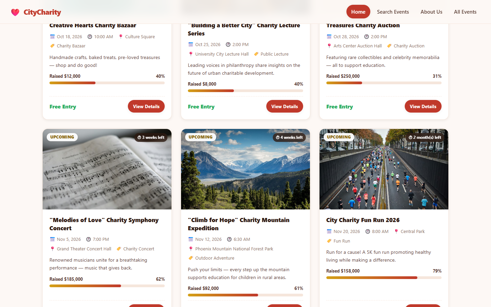
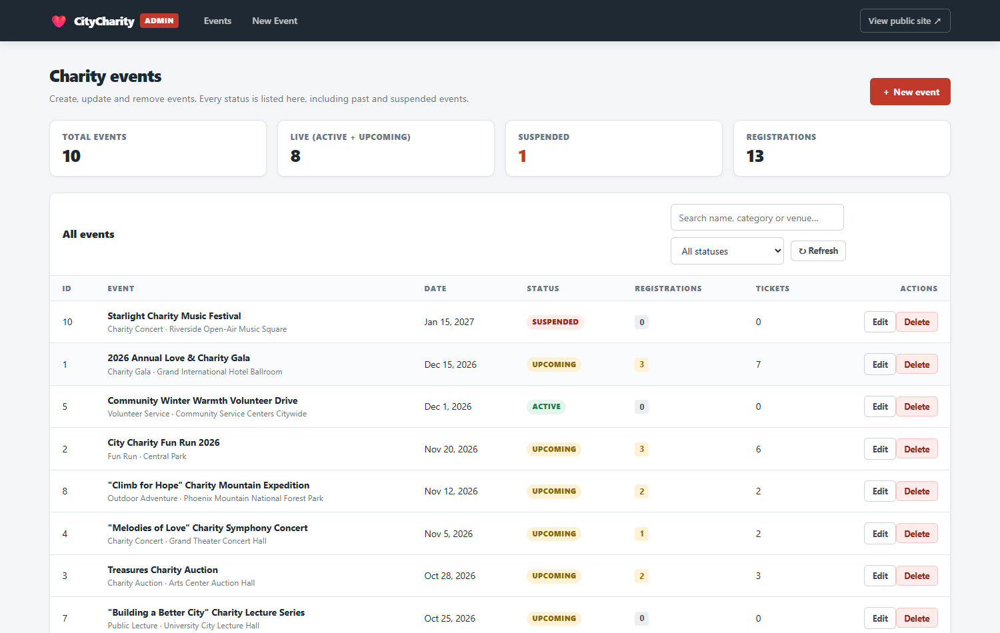

# City Charity Events Platform

**A three-tier dynamic web system — MySQL · Node.js/Express REST API · two Angular 22 (TypeScript) applications · Open-Meteo weather integration**

[](https://angular.dev/)
[](https://www.typescriptlang.org/)
[](https://nodejs.org/)
[](https://expressjs.com/)
[](https://www.mysql.com/)
[](https://restfulapi.net/)

---

## Table of Contents

- [1. Project Overview](#1-project-overview)
- [2. Innovation Highlights](#2-innovation-highlights)
- [3. System Architecture](#3-system-architecture)
- [4. Technology Stack](#4-technology-stack)
- [5. Database Design](#5-database-design)
- [6. API Reference](#6-api-reference)
- [7. Frontend Architecture (Angular 22)](#7-frontend-architecture-angular-22)
- [8. Weather Integration](#8-weather-integration)
- [9. Engineering Challenges \& Solutions](#9-engineering-challenges--solutions)
- [10. Demo Screenshots](#10-demo-screenshots)
- [11. Getting Started](#11-getting-started)
- [12. Deployment \& Submission Packaging](#12-deployment--submission-packaging)
- [13. Skills Demonstrated \& AI/ML Extensibility](#13-skills-demonstrated--aiml-extensibility)

---
---

# PART I — ENGLISH

---

## 1. Project Overview

The **City Charity Events Platform** connects charitable organisations with the public and gives staff the tools to manage the catalogue behind it. It is delivered as **three independently deployable applications** sharing one REST API and one relational database:

| Application | Stack | Port (dev) | Responsibility |
|---|---|---|---|
| **`clientside/`** — public website | Angular 22 + TypeScript | 4200 | Browse, search, inspect and register for events |
| **`adminside/`** — staff console | Angular 22 + TypeScript | 4300 | Full C.R.U.D. over events, registration oversight |
| **`api/`** — REST service | Node.js + Express + MySQL | 3000 | Data access, business rules, weather proxy |

**Capabilities delivered**

| Area | Capability |
|---|---|
| Public home | Live event grid with status badges, countdowns, fundraising progress |
| Search | Freely combinable filters: date, location (fuzzy), category, free-only |
| Event detail | Full record, organiser profile, fundraising progress, **registration list** |
| Registration | Dedicated page, validated form, confirmation receipt, capacity checks |
| Admin list | Every event regardless of status, with registration and ticket counts |
| Admin create / edit | Validated forms; edit view also surfaces that event's registrations |
| Admin delete | Blocked with HTTP **409** when registrations exist (data-integrity rule) |
| Weather | Live Open-Meteo forecast for each event's coordinates |

---

## 2. Innovation Highlights

### 2.1 Two independent Angular applications over one contract

Rather than shipping one SPA with an `/admin` section, the public site and the staff console are **separate Angular projects** with separate bundles, separate design systems and separate deployment targets. They share only the REST contract and a set of TypeScript domain models.

The consequence is real: the admin application never ships a byte of public-site code, and the public site has no concept of "delete" or "update" at all. The boundary is enforced by *build topology*, not by conditional rendering.

### 2.2 Business rules enforced at three layers

The rule *"an event with registrations must not be deleted"* is the clearest example of defence in depth:

| Layer | Enforcement |
|---|---|
| Database | `registrations.event_id` FK uses `ON DELETE RESTRICT` |
| API | Explicit `COUNT(*)` check → HTTP **409** with counts before attempting the delete |
| UI | Confirmation modal pre-warns, then renders the server's refusal verbatim |

If the API check were bypassed, MySQL would still refuse. If the UI were bypassed, the API would still refuse. **No single layer is trusted.**

### 2.3 Referential integrity that encodes policy

Foreign keys are chosen to express business meaning, not merely to exist:

| Relationship | Action | Why |
|---|---|---|
| `events.category_id → categories` | `RESTRICT` | A category still in use must not vanish |
| `events.org_id → organizations` | `SET NULL` | An organisation may leave; its events survive unassigned |
| `registrations.event_id → events` | `RESTRICT` | Attendee records must never be silently destroyed |

### 2.4 Uniqueness and capacity as database-level guarantees

*"One person may register for an event only once"* is enforced by `UNIQUE (event_id, attendee_email)`, not by a read-then-write check that could race. The API catches `ER_DUP_ENTRY` and translates it into a readable **409**. A `CHECK (tickets_purchased > 0)` constraint rejects nonsense quantities even if the API is bypassed.

### 2.5 Injection-safe, composable query builder

The search endpoint assembles one SQL statement at runtime while keeping every user value in a bound parameter array:

```js
// api/routes/events.js
if (date)     { sql += ' AND e.event_date = ?';            params.push(date); }
if (location) { sql += ' AND (e.location LIKE ? OR e.address LIKE ?)';
                params.push(`%${location}%`, `%${location}%`); }
if (category) { sql += ' AND c.category_id = ?';           params.push(parseInt(category, 10)); }
if (freeOnly) { sql += ' AND (e.ticket_price = 0 OR e.ticket_price IS NULL)'; }

const [rows] = await pool.execute(sql, params);   // prepared statement
```

Any combination of one to four filters works, with no combinatorial explosion of query variants and no string concatenation of user input.

### 2.6 Weather behind our own API boundary

The browser never calls Open-Meteo directly. `GET /api/weather` proxies upstream, translates the WMO weather codes into descriptions and icons **in one place**, enforces a 10-minute cache, applies an 8-second timeout, and returns our own envelope. Two front ends therefore render identical wording, and swapping the provider later changes one file.

### 2.7 A diagnosed timezone defect, fixed at the source

MySQL `DATE` columns were being converted by `mysql2` into JavaScript `Date` objects at local midnight, which `JSON.stringify` serialised as a UTC instant one day behind (`2026-10-17T16:00:00.000Z`). The client read the UTC day and rendered every event **one day early**, while countdowns printed `NaN month(s) left`.

The fix is two-layered — `dateStrings: true` in the pool (the cause) plus defensive date slicing on the client (the symptom):

```js
// api/event_db.js
dateStrings: true,

// clientside/src/app/shared/format.ts
const part = String(value).substring(0, 10);
```

### 2.8 Zoneless Angular with signals throughout

Angular 22 ships zoneless change detection by default. Every screen is therefore built on `signal()` / `computed()` / `input()` rather than imperative state, so updates propagate because the *data* changed — not because a zone happened to tick.

---

## 3. System Architecture

```
┌──────────────────────────┐        ┌──────────────────────────┐
│  clientside/  :4200      │        │  adminside/   :4300      │
│  Angular 22 + TypeScript │        │  Angular 22 + TypeScript │
│  home · search · detail  │        │  list · create · edit    │
│  registration · weather  │        │  delete · registrations  │
└────────────┬─────────────┘        └────────────┬─────────────┘
             │  HttpClient (typed)               │
             │  /api/** proxied in dev           │
             └───────────────┬───────────────────┘
                             │  HTTP / JSON
             ┌───────────────▼───────────────────────────────┐
             │            api/  :3000  (Express)             │
             │  cors · json · routes                         │
             │  ├── /api/events          read + CRUD         │
             │  ├── /api/registrations   create + list       │
             │  ├── /api/organizations   read                │
             │  └── /api/weather         Open-Meteo proxy    │
             └───────────────┬───────────────────────────────┘
                             │  mysql2 pool (10, keep-alive)
             ┌───────────────▼───────────────────────────────┐
             │        MySQL 8  ·  charityevents_db           │
             │  organizations ─┐                             │
             │                 ├── events ──> categories     │
             │  registrations ─┘  (FKs, ENUM, indexes)       │
             └───────────────────────────────────────────────┘
                             │
                    ┌────────▼─────────┐
                    │  Open-Meteo API  │  (server-to-server)
                    └──────────────────┘
```

**Request lifecycle — registering for an event**

1. User opens `/events/1` → `EventDetail` reads the `id` route param via `withComponentInputBinding()`
2. `EventService.getEventById(1)` → `GET /api/events/1`
3. API runs the event query, then a second query for registrations ordered `registration_date DESC`
4. API computes `progress_percentage`, `tickets_sold`, `tickets_remaining` server-side
5. Angular renders the detail view and passes `latitude`/`longitude` into `WeatherWidget`
6. `WeatherWidget` → `GET /api/weather` → Express proxies Open-Meteo → translated forecast
7. User clicks **Register now** → `/events/1/register`
8. `Registration` validates the reactive form, then `POST /api/registrations`
9. API validates, checks status, checks remaining capacity, inserts, returns **201**
10. Client swaps the form for a confirmation receipt

---

## 4. Technology Stack

### Front end (both applications)

| Technology | Version | Role |
|---|---|---|
| Angular | **22.2** | Standalone components, signals, lazy routes, zoneless CD |
| TypeScript | **6.0** | Strict typing end-to-end, shared domain models |
| Reactive Forms | Angular 22 | Validation with `Validators`, live value signals |
| `HttpClient` + `withFetch` | Angular 22 | Typed services, RxJS `Observable` pipelines |
| CSS3 | — | Two hand-built design systems (public warm, admin neutral) |

No component library, no Tailwind, no state-management library — the styling and state are written directly.

### Back end

| Technology | Version | Role |
|---|---|---|
| Node.js | ≥ 24.15 | Runtime (required by Angular 22 tooling) |
| Express | 4.x | Routing, middleware, JSON handling |
| mysql2 | 3.x | Promise API, connection pool, `dateStrings` |
| cors | 2.x | Cross-origin access for the two dev servers |
| better-sqlite3 | 13.x | Zero-config SQLite bootstrap for local demos |

### Data & external services

| Technology | Role |
|---|---|
| MySQL 8.x | InnoDB, `utf8mb4`, foreign keys with intentional actions, `ENUM`, `CHECK`, `UNIQUE`, indexes |
| Open-Meteo | Public forecast API, consumed server-side only |

---

## 5. Database Design

Four tables in **third normal form**, with `events` as the central fact table and `registrations` as the transactional detail table added in Assessment 3.

```
┌────────────────────┐        ┌─────────────────────┐
│   organizations    │        │     categories      │
├────────────────────┤        ├─────────────────────┤
│ org_id        PK   │        │ category_id    PK   │
│ org_name           │        │ category_name       │
│ mission_statement  │        │ category_description│
│ description        │        │ icon_class          │
│ contact_*          │        └──────────┬──────────┘
│ website_url        │                   │
└─────────┬──────────┘                   │ ON DELETE RESTRICT
          │ ON DELETE SET NULL           │
          │                              │
     ┌────▼──────────────────────────────▼──────┐
     │                 events                    │
     ├───────────────────────────────────────────┤
     │ event_id            PK                    │
     │ event_name · short_description            │
     │ full_description                          │
     │ category_id         FK → categories       │
     │ org_id              FK → organizations    │
     │ event_date · event_time                   │
     │ location · address                        │
     │ latitude · longitude    ← weather         │
     │ image_url                                 │
     │ ticket_price · goal_amount · current_amount│
     │ status ENUM(upcoming|active|past|suspended)│
     │ max_participants · organizer_contact       │
     │ created_at · updated_at                    │
     │ INDEX (status) (event_date) (category_id)  │
     └───────────────────┬───────────────────────┘
                         │ ON DELETE RESTRICT
     ┌───────────────────▼───────────────────────┐
     │              registrations                 │
     ├────────────────────────────────────────────┤
     │ registration_id      PK                    │
     │ event_id             FK → events           │
     │ attendee_name                              │
     │ attendee_email                             │
     │ attendee_phone                             │
     │ tickets_purchased    CHECK > 0             │
     │ registration_date    DEFAULT CURRENT_TIMESTAMP │
     │ special_requests                           │
     │ UNIQUE (event_id, attendee_email)  ← 1 per event │
     │ INDEX (event_id) (registration_date)       │
     └────────────────────────────────────────────┘
```

**Design rationale**

| Decision | Justification |
|---|---|
| 3NF normalisation | An organisation's contact details exist in exactly one row — no update anomalies |
| `ENUM` for `status` | The lifecycle vocabulary is enforced by the database; invalid states are unrepresentable |
| `DECIMAL(12,2)` for money | Exact decimal arithmetic; floating point would corrupt fundraising totals |
| `UNIQUE (event_id, attendee_email)` | Implements "one registration per person per event" as a hard guarantee, not a hope |
| `CHECK (tickets_purchased > 0)` | Rejects nonsensical quantities beneath the API layer |
| `ON DELETE RESTRICT` on registrations | Protects attendee records; makes the 409 rule structural |
| Indexes on `status`, `event_date`, `category_id` | Exactly the columns used by the filters and sort order |
| `latitude` / `longitude` | Required by Open-Meteo to produce a venue forecast |

**Seed dataset:** 4 organisations · 8 categories · 10 events · **13 registrations** across 6 events. Events 5, 7, 9 and 10 intentionally have **no** registrations so the admin delete flow can be demonstrated both as blocked (409) and as successful.

The entire schema **and** data live in a single importable file: `database/charityevents_db.sql`.

---

## 6. API Reference

Base URL: `http://localhost:3000/api`

### Events

| Method | Endpoint | Purpose |
|---|---|---|
| `GET` | `/api` | Service discovery / endpoint index |
| `GET` | `/api/health` | Database health probe |
| `GET` | `/api/events` | Upcoming + active events (public home) |
| `GET` | `/api/events/search` | Combinable filtering (public search) |
| `GET` | `/api/events/categories/list` | Categories with live event counts |
| `GET` | `/api/events/admin/all` | **Every** event, all statuses, with registration counts |
| `GET` | `/api/events/:id` | Full detail **including its registration list** |
| `POST` | `/api/events` | Create an event |
| `PUT` | `/api/events/:id` | Update an event (full or partial payload) |
| `DELETE` | `/api/events/:id` | Delete — **409 if registrations exist** |

> Route order matters: `/admin/all` is declared before `/:id`, otherwise Express would match `admin` as an event id.

### Registrations

| Method | Endpoint | Purpose |
|---|---|---|
| `GET` | `/api/registrations?eventId=3` | List registrations, optionally scoped to one event |
| `POST` | `/api/registrations` | Create a registration (ticket purchase) |

### Organisations & weather

| Method | Endpoint | Purpose |
|---|---|---|
| `GET` | `/api/organizations` | Organisations for the admin dropdown |
| `GET` | `/api/weather?lat=&lon=&timezone=` | Translated Open-Meteo forecast |
| `GET` | `/api/weather/codes` | WMO code → description/icon legend |

### Search parameters

| Param | Type | Behaviour |
|---|---|---|
| `date` | `YYYY-MM-DD` | Exact date match |
| `location` | string | **Fuzzy** — `LIKE %…%` against both `location` and `address` |
| `category` | int | Exact category id |
| `freeOnly` | `1` | Only `ticket_price = 0` or `NULL` |

All optional and freely combinable.

### Status codes

| Code | Meaning |
|---|---|
| `200` | Success |
| `201` | Resource created |
| `400` | Validation failure (with an `errors[]` array) |
| `404` | Unknown event |
| `409` | Business rule conflict — duplicate registration, full capacity, or event has registrations |
| `500` | Unexpected server fault |
| `502` / `504` | Upstream weather service failure / timeout |

### Response envelope

```json
{ "success": true, "count": 3, "data": [ ... ] }
{ "success": false, "message": "Validation failed", "errors": ["Email is required"] }
```

---

## 7. Frontend Architecture (Angular 22)

Both applications follow the same shape:

```
src/app/
├── app.ts / app.html            # shell: navbar + router-outlet + footer
├── app.config.ts                # providers: router, HttpClient, scrolling
├── app.routes.ts                # lazy loadComponent per screen
├── core/
│   ├── config/api.config.ts     # single API base
│   ├── models/*.ts              # typed contract with the API
│   └── services/*.ts            # HTTP + error normalisation
├── shared/                      # reusable presentation
└── pages/                       # one folder per screen
```

**Angular 22 features used deliberately**

| Feature | Where it matters |
|---|---|
| **Signals** (`signal`, `computed`, `input`) | Every component holds state as signals, so zoneless change detection works without `markForCheck` |
| **Standalone components** | No `NgModule` anywhere; each component declares exactly what it imports |
| **Lazy `loadComponent`** | Only the shell + current screen are downloaded |
| **`withComponentInputBinding()`** | `/events/:id` binds straight into `readonly id = input.required<string>()` |
| **Reactive Forms** | Validation on registration and admin create/edit, with live value signals |
| **Typed HTTP services** | Components never touch `HttpClient` directly; they receive `Observable<CharityEvent>` |
| **`takeUntilDestroyed`** | Weather subscriptions cannot outlive their component |

**Error handling** is centralised in one function per app, `extractApiError()`, which prefers field-level `errors[]`, then `message`, and falls back to a network-specific hint when `status === 0`.

**Public routes**

| Route | Screen |
|---|---|
| `/` | Home — hero, about, live event grid |
| `/search` | Search — four combinable filters |
| `/events/:id` | Detail — record, organiser, progress, **registrations**, weather |
| `/events/:id/register` | Registration — validated form + confirmation |

**Admin routes**

| Route | Screen |
|---|---|
| `/` | Dashboard — headline figures, status and category mix, recent registrations, fundraising leaderboard |
| `/events` | Event list — stats, search, status/category filters, sorting, edit/delete |
| `/events/new` | Create form |
| `/events/:id/edit` | Edit form + that event's registrations |

A few interaction details matter in day-to-day use: **column sorting** on seven fields (status sorts by lifecycle rather than alphabetically), **independent text / status / category filters** with a one-click reset, a **per-row shortcut** to the public page, a delete dialog that **moves focus to the confirm button and closes on `Esc`**, **auto-dismissing** confirmations, and a route guard that **refuses to discard a half-filled form**.

---

## 8. Weather Integration

```
Angular WeatherWidget
        │  GET /api/weather?lat=39.9087&lon=116.4576&timezone=Asia/Shanghai
        ▼
Express /api/weather
        │  · validates lat/lon ranges
        │  · 10-minute in-memory cache
        │  · 8-second AbortController timeout
        │  · translates WMO codes → description + icon + group
        ▼
https://api.open-meteo.com/v1/forecast
        ?latitude=…&longitude=…
        &daily=weather_code,temperature_2m_max,temperature_2m_min,precipitation_probability_max
        &forecast_days=7&timezone=…
```

**Why proxy rather than call the API from the browser?**

1. **No third-party CORS dependency** — our origin is the only one that matters.
2. **One translation table** — both applications render identical wording for code `95`.
3. **Caching** — ten page views do not become ten upstream requests.
4. **Timeout control** — a slow third party cannot hang the UI indefinitely.
5. **Swap-friendly** — replacing Open-Meteo changes one file, not every component.

The widget degrades gracefully: no coordinates → neutral notice; upstream failure → the error text; during load → a placeholder. It never renders a broken box.

---

## 9. Engineering Challenges & Solutions

### Challenge 1 — Enforcing “one registration per person per event”

**Problem:** A read-then-insert check races under concurrent submissions; two requests can both see "not registered" and both insert.
**Solution:** A `UNIQUE (event_id, attendee_email)` constraint makes the guarantee structural. The API still pre-checks for a friendly message, but the database is the authority, and `ER_DUP_ENTRY` is translated into HTTP **409**.

### Challenge 2 — Deleting an event without destroying attendee history

**Problem:** The natural `ON DELETE CASCADE` would silently erase registrations.
**Solution:** `ON DELETE RESTRICT` plus an explicit pre-flight `COUNT(*)`. The API returns **409** with `registration_count` and `tickets_sold`, which the admin UI renders verbatim: *"This event cannot be deleted because it already has registrations. (3 registration(s), 7 ticket(s))"*.

### Challenge 3 — Keeping event visibility a data concern

**Problem:** Which events appear publicly could easily scatter across queries.
**Solution:** Every public query carries `WHERE status IN ('upcoming','active')`. The admin endpoint deliberately omits it. Suspending an event is a single `UPDATE`, and the event disappears from both the home page and search simultaneously.

### Challenge 4 — Diagnosing a cross-tier timezone bug

**Problem:** Every event rendered one day early and countdowns read `NaN month(s) left`, with no console error and a syntactically valid API response.
**Solution:** Traced the value through all three tiers — `mysql2` was converting `DATE` into a JS `Date` at local midnight, which serialised as a UTC instant one day behind. Fixed at the source (`dateStrings: true`) and defended on the client (slice to 10 characters, guard `isNaN`).

### Challenge 5 — Two SPAs, one API, no CORS surprises

**Problem:** Three services on three ports invite CORS failures and hard-coded hostnames.
**Solution:** Each Angular project ships a `proxy.conf.json` mapping `/api` → `:3000`, so application code uses the relative base `/api` and knows no hostnames. The API enables `cors()` as a belt-and-braces measure for split-origin deployment.

### Challenge 6 — Zoneless change detection with reactive forms

**Problem:** Angular 22 does not use zones; state written to plain fields would never re-render.
**Solution:** All mutable state is a signal, and derived values (totals, filtered rows, stats) are `computed()`. Form values that drive the UI are bridged with `toSignal(form.valueChanges)`, so the live "Total due" updates as the ticket count changes.

### Challenge 7 — N+1 queries on the detail page

**Problem:** An event plus its registrations, category and organisation invites four queries per request.
**Solution:** One `JOIN`ed event query plus one registration query — a constant two round-trips, with aggregates (`tickets_sold`, `tickets_remaining`, `progress_percentage`) computed once on the server so both front ends display identical numbers.

---

## 10. Demo Screenshots

All images are live captures of the running system against the MySQL database.

### Public website

| Home — hero and live statistics | Home — dynamic event grid |
|---|---|
|  |  |

The hero figures are computed from the API response, not hard-coded. Each card carries a status badge, a live countdown and a fundraising progress bar.

| Search — filtered results with highlighting | Event detail — registrations, progress, weather |
|---|---|
|  |  |


### Admin console

| Dashboard — live overview | Event list with registration counts |
|---|---|
|  |  |


---

## 11. Getting Started

### Prerequisites

- **Node.js ≥ 24.15** (required by the Angular 22 toolchain)
- **MySQL 8.x** running locally
- npm 11+

### 1 · Create and seed the database

```bash
mysql -u root -p < database/charityevents_db.sql
```

This creates `charityevents_db` with all four tables and seeds 10 events / 13 registrations. The file is BOM-free and safe to re-run — it drops and recreates the schema.

### 2 · Start the API

```bash
cd api
npm install
node server.js
```

Expected output:

```
MySQL database connected successfully!
  Events: 10 | Categories: 8
  API:       http://localhost:3000/api
```

### 3 · Start the public website

```bash
cd clientside
npm install
npm start          # ng serve → http://localhost:4200
```

### 4 · Start the admin console

```bash
cd adminside
npm install
npm start          # ng serve → http://localhost:4300
```

| Service | URL |
|---|---|
| Public website | http://localhost:4200 |
| Admin console | http://localhost:4300 |
| API | http://localhost:3000/api |

### Optional — without MySQL

```bash
cd api && node db_init.js   # builds a standalone SQLite database
```

---

## 12. Deployment & Submission Packaging

### Three archives, as required

| Archive | Contents |
|---|---|
| `usernameA3-clientside.zip` | the whole `clientside/` project (source, `package.json`, `proxy.conf.json`, `angular.json`) |
| `usernameA3-adminside.zip` | the whole `adminside/` project |
| `usernameA3-api.zip` | `api/` source **plus** `database/charityevents_db.sql` |

**Exclude before zipping:** `node_modules/`, `dist/`, `.angular/`, `*.log`. Markers run `npm install` themselves.

### Building for production

```bash
cd clientside && npm run build     # → dist/clientside/browser
cd adminside  && npm run build     # → dist/adminside/browser
```

### Deploying to SCU cPanel

1. Upload the API, then run `npm install --omit=dev` and start it via the cPanel Node.js application manager (or `Passenger`).
2. Import `charityevents_db.sql` through phpMyAdmin.
3. Update `api/event_db.js` with the cPanel MySQL credentials.
4. Upload each `dist/*/browser` folder to its own document root.
5. Edit `clientside/src/app/core/config/api.config.ts` and `adminside/src/app/core/config/api.config.ts` so `API_BASE` points at the deployed API, then rebuild — or deploy the API on the same domain and keep the relative `/api`.

> Each student must deploy to their **own** cPanel account.

---

## 13. Skills Demonstrated & AI/ML Extensibility

| Competency | Evidence |
|---|---|
| Relational modelling | 4 tables in 3NF, `UNIQUE`, `CHECK`, `ENUM`, intentional FK actions, indexing |
| SQL | Multi-table `JOIN`s, correlated `COUNT` subqueries, dynamic `WHERE`, `GROUP BY` aggregates |
| API engineering | Full C.R.U.D., correct HTTP semantics (200/201/400/404/409), uniform envelopes |
| Security | Prepared statements, parameter validation, constraint-backed uniqueness, no secret leakage in errors |
| TypeScript | Strict domain models shared across services and templates; no `any` in application code |
| Angular architecture | Standalone components, signals, zoneless CD, lazy routes, typed services, reactive forms |
| Reactive programming | RxJS `Observable` pipelines, `takeUntilDestroyed`, `toSignal` bridges |
| Architecture | Three independently deployable apps on one contract; server-side third-party integration |
| Correctness | Cross-tier timezone bug diagnosed and fixed; capacity and uniqueness enforced structurally |

### Toward AI/ML

The system already exposes the interfaces an intelligent layer would need:

| Direction | Existing foundation |
|---|---|
| **Recommendation** | `events`, `categories`, `organizations`, `registrations` form a ready user–item interaction matrix |
| **Demand forecasting** | `(event_date, target_capacity, tickets_sold)` is structured time-series data |
| **Semantic search** | `full_description` is a natural embedding corpus; swap the `LIKE` clause for vector similarity behind the same endpoint |
| **Natural-language search** | An LLM can already emit exactly the `{date, location, category, freeOnly}` object the endpoint accepts |
| **Content moderation** | `status = 'suspended'` is the manual hook a classifier would write to |
| **Anomaly detection** | Registration velocity per event is a simple, meaningful signal |

The key architectural property: **the front ends depend only on the JSON contract**. A model-backed service can replace or extend `/api/events/search`, or add `/api/recommendations`, without changing a single Angular component.

---
---

# 第二部分 — 中文版

---

## 1. 项目概述

**城市慈善活动平台** 连接慈善组织与公众，同时为工作人员提供后台管理能力。系统由**三个可独立部署的应用**组成，共享同一套 REST API 与关系型数据库：

| 应用 | 技术栈 | 开发端口 | 职责 |
|---|---|---|---|
| **`clientside/`** 公众网站 | Angular 22 + TypeScript | 4200 | 浏览、搜索、查看详情、活动报名 |
| **`adminside/`** 管理后台 | Angular 22 + TypeScript | 4300 | 活动完整增删改查、报名数据查看 |
| **`api/`** REST 服务 | Node.js + Express + MySQL | 3000 | 数据访问、业务规则、天气代理 |

**已实现能力**

| 模块 | 能力 |
|---|---|
| 首页 | 实时活动网格、状态徽章、倒计时、筹款进度 |
| 搜索 | 日期、地点（模糊）、类别、仅免费 四条件自由组合 |
| 活动详情 | 完整信息、主办方档案、筹款进度、**报名列表** |
| 活动报名 | 独立页面、表单校验、报名确认、名额限制 |
| 后台列表 | 全状态活动列表，含报名数与票数统计 |
| 后台新建 / 编辑 | 带校验的表单；编辑页同时展示该活动的报名数据 |
| 后台删除 | 存在报名时以 HTTP **409** 拒绝（数据完整性规则） |
| 天气 | 基于活动经纬度的 Open-Meteo 实时预报 |

---

## 2. 创新点

### 2.1 一个契约，两个独立的 Angular 应用

公众网站与管理后台是**两个独立的 Angular 工程**，各自拥有独立的打包产物、设计系统和部署目标，只共享 REST 契约与 TypeScript 领域模型。

其价值是实质性的：管理端不会打包任何公众站代码，公众站也完全不含"删除""更新"的概念。这条边界由**构建拓扑**保证，而不是靠条件渲染来"藏起来"。

### 2.2 业务规则在三层同时落实

以"有报名的活动不可删除"为例：

| 层次 | 落实方式 |
|---|---|
| 数据库 | `registrations.event_id` 外键使用 `ON DELETE RESTRICT` |
| API | 删除前显式 `COUNT(*)` 检查，返回 HTTP **409** 及具体数量 |
| 界面 | 确认弹窗预先提示，并原样呈现服务端的拒绝原因 |

即使绕过 API 检查，MySQL 仍会拒绝；即使绕过界面，API 仍会拒绝。**任何一层都不被单独信任。**

### 2.3 体现业务语义的外键引用动作

| 关系 | 动作 | 理由 |
|---|---|---|
| `events.category_id → categories` | `RESTRICT` | 仍在使用的类别不可消失 |
| `events.org_id → organizations` | `SET NULL` | 组织可退出，其活动保留为未归属 |
| `registrations.event_id → events` | `RESTRICT` | 报名者记录绝不能被静默销毁 |

### 2.4 唯一性与名额作为数据库级保证

"同一人同一活动只能报名一次"由 `UNIQUE (event_id, attendee_email)` 保证，而不是"先查后写"这种并发下会失效的逻辑。API 捕获 `ER_DUP_ENTRY` 并转换为可读的 **409**。`CHECK (tickets_purchased > 0)` 则在绕过 API 时仍能拒绝荒谬的票数。

### 2.5 防注入的可组合查询构建器

搜索接口在运行时拼装单条 SQL，而所有用户输入统一进入绑定参数数组：

```js
if (date)     { sql += ' AND e.event_date = ?';            params.push(date); }
if (location) { sql += ' AND (e.location LIKE ? OR e.address LIKE ?)';
                params.push(`%${location}%`, `%${location}%`); }
if (category) { sql += ' AND c.category_id = ?';           params.push(parseInt(category, 10)); }

const [rows] = await pool.execute(sql, params);   // 预编译语句
```

1 到 4 个条件的任意组合都能正确工作，无需穷举查询变体，也不存在字符串拼接用户输入。

### 2.6 把天气放在自己的 API 边界之后

浏览器从不直接调用 Open-Meteo。`GET /api/weather` 负责代理上游、在**一处**翻译 WMO 天气代码、实施 10 分钟缓存、8 秒超时，并返回自有响应信封。因此两个前端渲染出完全一致的文案，将来更换服务商只需改一个文件。

### 2.7 定位并根治的时区缺陷

`mysql2` 会把 MySQL 的 `DATE` 转成本地零点的 JS `Date`，经 `JSON.stringify` 变成比本地日期少一天的 UTC 时刻（`2026-10-17T16:00:00.000Z`）。前端读取 UTC 日号，导致所有活动**提前一天**显示，倒计时输出 `NaN month(s) left`。

修复分两层 —— 连接池的 `dateStrings: true`（治因）+ 客户端日期截断（治症）：

```js
// api/event_db.js
dateStrings: true,

// clientside/src/app/shared/format.ts
const part = String(value).substring(0, 10);
```

### 2.8 全信号驱动的无 Zone Angular

Angular 22 默认使用无 Zone 变更检测。因此每个页面都建立在 `signal()` / `computed()` / `input()` 之上，而不是命令式状态 —— 更新之所以发生，是因为**数据变了**，而不是因为某个 zone 碰巧触发。

---

## 3. 系统架构

```
┌──────────────────────────┐        ┌──────────────────────────┐
│  clientside/  :4200      │        │  adminside/   :4300      │
│  Angular 22 + TypeScript │        │  Angular 22 + TypeScript │
│  首页·搜索·详情·报名·天气 │        │  列表·新建·编辑·删除     │
└────────────┬─────────────┘        └────────────┬─────────────┘
             │  HttpClient（强类型）             │
             │  开发期 /api 走代理               │
             └───────────────┬───────────────────┘
                             │  HTTP / JSON
             ┌───────────────▼───────────────────────────────┐
             │            api/  :3000  (Express)             │
             │  cors · json · routes                         │
             │  ├── /api/events          读取 + CRUD         │
             │  ├── /api/registrations   创建 + 列表         │
             │  ├── /api/organizations   读取                │
             │  └── /api/weather         Open-Meteo 代理     │
             └───────────────┬───────────────────────────────┘
                             │  mysql2 连接池（10，keep-alive）
             ┌───────────────▼───────────────────────────────┐
             │        MySQL 8  ·  charityevents_db           │
             │  organizations ─┐                             │
             │                 ├── events ──> categories     │
             │  registrations ─┘  （外键、ENUM、索引）        │
             └───────────────────────────────────────────────┘
                             │
                    ┌────────▼─────────┐
                    │  Open-Meteo API  │  （仅服务端调用）
                    └──────────────────┘
```

**请求生命周期 —— 报名流程**

1. 用户访问 `/events/1`，`EventDetail` 通过 `withComponentInputBinding()` 直接取得 `id` 路由参数
2. `EventService.getEventById(1)` → `GET /api/events/1`
3. API 执行活动查询，再以 `registration_date DESC` 查询报名列表
4. API 在服务端计算 `progress_percentage`、`tickets_sold`、`tickets_remaining`
5. Angular 渲染详情页，并把 `latitude`/`longitude` 传给 `WeatherWidget`
6. `WeatherWidget` → `GET /api/weather` → Express 代理 Open-Meteo → 返回翻译后的预报
7. 用户点击 **Register now** → `/events/1/register`
8. `Registration` 校验响应式表单后 `POST /api/registrations`
9. API 校验参数、检查状态、检查剩余名额、写入、返回 **201**
10. 前端把表单替换为报名确认回执

---

## 4. 技术栈

### 前端（两个应用）

| 技术 | 版本 | 作用 |
|---|---|---|
| Angular | **22.2** | 独立组件、信号、路由懒加载、无 Zone 变更检测 |
| TypeScript | **6.0** | 端到端强类型，共享领域模型 |
| Reactive Forms | Angular 22 | 基于 `Validators` 的校验与实时值信号 |
| `HttpClient` + `withFetch` | Angular 22 | 强类型服务、RxJS `Observable` 管线 |
| CSS3 | — | 两套自建设计系统（公众站暖色、后台中性色） |

未使用任何组件库、Tailwind 或状态管理库 —— 样式与状态全部手写。

### 后端

| 技术 | 版本 | 作用 |
|---|---|---|
| Node.js | ≥ 24.15 | 运行时（Angular 22 工具链要求） |
| Express | 4.x | 路由、中间件、JSON 处理 |
| mysql2 | 3.x | Promise API、连接池、`dateStrings` |
| cors | 2.x | 允许两个开发服务器跨域访问 |
| better-sqlite3 | 13.x | 零配置 SQLite 引导，便于本地演示 |

### 数据与外部服务

| 技术 | 作用 |
|---|---|
| MySQL 8.x | InnoDB、`utf8mb4`、语义化外键动作、`ENUM`、`CHECK`、`UNIQUE`、索引 |
| Open-Meteo | 公共天气预报接口，仅由服务端调用 |

---

## 5. 数据库设计

四张 **第三范式** 表，以 `events` 为核心事实表，`registrations` 为 A3 新增的事务明细表。

```
┌────────────────────┐        ┌─────────────────────┐
│   organizations    │        │     categories      │
├────────────────────┤        ├─────────────────────┤
│ org_id        PK   │        │ category_id    PK   │
│ org_name           │        │ category_name       │
│ mission_statement  │        │ category_description│
│ description        │        │ icon_class          │
│ contact_*          │        └──────────┬──────────┘
│ website_url        │                   │
└─────────┬──────────┘                   │ ON DELETE RESTRICT
          │ ON DELETE SET NULL           │
     ┌────▼──────────────────────────────▼──────┐
     │                 events                    │
     ├───────────────────────────────────────────┤
     │ event_id            PK                    │
     │ event_name · short_description            │
     │ full_description                          │
     │ category_id         FK → categories       │
     │ org_id              FK → organizations    │
     │ event_date · event_time                   │
     │ location · address                        │
     │ latitude · longitude    ← 天气            │
     │ image_url                                 │
     │ ticket_price · goal_amount · current_amount│
     │ status ENUM(upcoming|active|past|suspended)│
     │ max_participants · organizer_contact       │
     │ created_at · updated_at                    │
     │ INDEX (status) (event_date) (category_id)  │
     └───────────────────┬───────────────────────┘
                         │ ON DELETE RESTRICT
     ┌───────────────────▼───────────────────────┐
     │              registrations                 │
     ├────────────────────────────────────────────┤
     │ registration_id      PK                    │
     │ event_id             FK → events           │
     │ attendee_name                              │
     │ attendee_email                             │
     │ attendee_phone                             │
     │ tickets_purchased    CHECK > 0             │
     │ registration_date    DEFAULT CURRENT_TIMESTAMP │
     │ special_requests                           │
     │ UNIQUE (event_id, attendee_email)  ← 每人每活动一次 │
     │ INDEX (event_id) (registration_date)       │
     └────────────────────────────────────────────┘
```

**设计理由**

| 决策 | 依据 |
|---|---|
| 3NF 规范化 | 组织联系方式只存在一行，杜绝更新异常 |
| `status` 使用 `ENUM` | 生命周期词汇由数据库强制，非法状态无法表示 |
| 金额使用 `DECIMAL(12,2)` | 精确十进制运算，浮点会破坏筹款统计 |
| `UNIQUE (event_id, attendee_email)` | 把"每人每活动只能报名一次"变成硬保证，而非期望 |
| `CHECK (tickets_purchased > 0)` | 在 API 之下再次拒绝无意义票数 |
| 报名表使用 `ON DELETE RESTRICT` | 保护报名者记录，使 409 规则成为结构性约束 |
| 在 `status`、`event_date`、`category_id` 建索引 | 正是筛选与排序使用的列 |
| `latitude` / `longitude` | Open-Meteo 生成场馆预报所必需 |

**种子数据：** 4 个组织 · 8 个类别 · 10 个活动 · **13 条报名**，分布在 6 个活动上。活动 5、7、9、10 特意**没有**报名，以便演示后台删除的两种结果（被 409 拒绝 / 删除成功）。

完整结构与数据集中在单一可导入文件：`database/charityevents_db.sql`。

---

## 6. API 接口说明

基础地址：`http://localhost:3000/api`

### 活动

| 方法 | 端点 | 用途 |
|---|---|---|
| `GET` | `/api` | 服务发现 / 端点索引 |
| `GET` | `/api/health` | 数据库健康检查 |
| `GET` | `/api/events` | 进行中 + 即将举行（首页） |
| `GET` | `/api/events/search` | 组合筛选（搜索页） |
| `GET` | `/api/events/categories/list` | 类别及其实时活动数 |
| `GET` | `/api/events/admin/all` | **全部**活动，所有状态，含报名统计 |
| `GET` | `/api/events/:id` | 完整详情 **含报名列表** |
| `POST` | `/api/events` | 新建活动 |
| `PUT` | `/api/events/:id` | 更新活动（支持完整或部分字段） |
| `DELETE` | `/api/events/:id` | 删除 —— **有报名时返回 409** |

> 路由顺序很关键：`/admin/all` 必须声明在 `/:id` 之前，否则 Express 会把 `admin` 当成活动 id。

### 报名

| 方法 | 端点 | 用途 |
|---|---|---|
| `GET` | `/api/registrations?eventId=3` | 报名列表，可按活动过滤 |
| `POST` | `/api/registrations` | 创建报名（购票） |

### 组织与天气

| 方法 | 端点 | 用途 |
|---|---|---|
| `GET` | `/api/organizations` | 后台下拉框所需的组织列表 |
| `GET` | `/api/weather?lat=&lon=&timezone=` | 翻译后的 Open-Meteo 预报 |
| `GET` | `/api/weather/codes` | WMO 代码 → 描述/图标对照表 |

### 搜索参数

| 参数 | 类型 | 行为 |
|---|---|---|
| `date` | `YYYY-MM-DD` | 精确日期匹配 |
| `location` | 字符串 | **模糊匹配** —— 对 `location` 与 `address` 同时 `LIKE %…%` |
| `category` | 整数 | 精确类别 id |
| `freeOnly` | `1` | 仅 `ticket_price = 0` 或 `NULL` |

全部可选且可自由组合。

### 状态码

| 码 | 含义 |
|---|---|
| `200` | 成功 |
| `201` | 资源已创建 |
| `400` | 校验失败（附带 `errors[]`） |
| `404` | 活动不存在 |
| `409` | 业务冲突 —— 重复报名、名额已满、或活动存在报名 |
| `500` | 服务端异常 |
| `502` / `504` | 上游天气服务失败 / 超时 |

### 统一响应信封

```json
{ "success": true, "count": 3, "data": [ ... ] }
{ "success": false, "message": "Validation failed", "errors": ["Email is required"] }
```

---

## 7. 前端架构（Angular 22）

两个应用采用同一套结构：

```
src/app/
├── app.ts / app.html            # 外壳：导航栏 + router-outlet + 页脚
├── app.config.ts                # providers：路由、HttpClient、滚动恢复
├── app.routes.ts                # 每个页面懒加载
├── core/
│   ├── config/api.config.ts     # 单一 API 基址
│   ├── models/*.ts              # 与 API 对应的强类型契约
│   └── services/*.ts            # HTTP 与错误归一化
├── shared/                      # 可复用展示组件
└── pages/                       # 一页一目录
```

**刻意使用的 Angular 22 特性**

| 特性 | 价值所在 |
|---|---|
| **Signals**（`signal`、`computed`、`input`） | 组件状态全部是信号，因此无需 `markForCheck` 也能在无 Zone 下更新 |
| **独立组件** | 全工程无 `NgModule`，每个组件显式声明自己需要的依赖 |
| **`loadComponent` 懒加载** | 首屏只下载外壳 + 当前页面 |
| **`withComponentInputBinding()`** | `/events/:id` 直接绑定到 `readonly id = input.required<string>()` |
| **Reactive Forms** | 报名页与后台表单的校验，并以信号桥接实时值 |
| **强类型 HTTP 服务** | 组件不直接接触 `HttpClient`，只接收 `Observable<CharityEvent>` |
| **`takeUntilDestroyed`** | 天气订阅不会超出组件生命周期 |

**错误处理**统一收敛在每个应用的 `extractApiError()`：优先取字段级 `errors[]`，其次 `message`，`status === 0` 时给出网络层提示。

**公众站路由**

| 路由 | 页面 |
|---|---|
| `/` | 首页 —— 主视觉、关于我们、实时活动网格 |
| `/search` | 搜索 —— 四条件组合筛选 |
| `/events/:id` | 详情 —— 记录、主办方、进度、**报名列表**、天气 |
| `/events/:id/register` | 报名 —— 校验表单 + 确认回执 |

**后台路由**

| 路由 | 页面 |
|---|---|
| `/` | 仪表盘 —— 关键指标、状态与类别分布、最新报名、筹款排行 |
| `/events` | 活动列表 —— 统计、搜索、状态/类别过滤、排序、编辑/删除 |
| `/events/new` | 新建表单 |
| `/events/:id/edit` | 编辑表单 + 该活动的报名数据 |

日常使用中真正影响效率的细节也已处理：**七列可排序**（状态按生命周期排序而非字母序）、**文本 / 状态 / 类别三个独立筛选**并支持一键重置、每行提供**跳转公开页**的快捷入口、删除弹窗**自动聚焦确认按钮并可 `Esc` 关闭**、成功提示**自动消失**，以及**离开半填表单时拦截**的路由守卫。

---

## 8. 天气集成

```
Angular WeatherWidget
        │  GET /api/weather?lat=39.9087&lon=116.4576&timezone=Asia/Shanghai
        ▼
Express /api/weather
        │  · 校验经纬度范围
        │  · 10 分钟内存缓存
        │  · 8 秒 AbortController 超时
        │  · WMO 代码 → 描述 + 图标 + 分类
        ▼
https://api.open-meteo.com/v1/forecast
        ?latitude=…&longitude=…
        &daily=weather_code,temperature_2m_max,temperature_2m_min,precipitation_probability_max
        &forecast_days=7&timezone=…
```

**为什么用代理而不是浏览器直连？**

1. **不依赖第三方 CORS** —— 只需要信任自己的源。
2. **唯一翻译表** —— 两个应用对代码 `95` 渲染完全一致的文案。
3. **缓存** —— 十次页面浏览不会变成十次上游请求。
4. **超时可控** —— 第三方变慢不会无限期拖住界面。
5. **便于替换** —— 更换服务商只需改一个文件，而非所有组件。

组件的降级路径完整：无经纬度 → 中性提示；上游失败 → 错误文案；加载中 → 占位。任何时候都不会渲染出一个坏掉的空框。

---

## 9. 技术难点与解决方案

### 难点 1 —— 保证"每人每活动只能报名一次"

**问题：** "先查再插"在并发下存在竞态，两个请求可能同时判定"未报名"并各自插入。
**方案：** 用 `UNIQUE (event_id, attendee_email)` 让保证成为结构性约束。API 仍做预检查以给出友好提示，但数据库才是权威，`ER_DUP_ENTRY` 被转换为 HTTP **409**。

### 难点 2 —— 删除活动而不销毁报名历史

**问题：** 天然选择 `ON DELETE CASCADE` 会静默清除报名记录。
**方案：** `ON DELETE RESTRICT` 加上显式预检 `COUNT(*)`。API 返回 **409** 并附带 `registration_count` 与 `tickets_sold`，后台界面原样呈现：*"This event cannot be deleted because it already has registrations. (3 registration(s), 7 ticket(s))"*。

### 难点 3 —— 让"活动可见性"成为数据层的职责

**问题：** 哪些活动对公众可见，很容易散落到各个查询里。
**方案：** 所有公众查询统一携带 `WHERE status IN ('upcoming','active')`，后台接口则刻意不带。暂停一个活动只需一条 `UPDATE`，它会同时从首页和搜索结果中消失。

### 难点 4 —— 定位跨层时区 Bug

**问题：** 所有活动日期提前一天、倒计时显示 `NaN month(s) left`，但控制台无报错，API 响应语法合法。
**方案：** 在三层之间追踪同一个值 —— `mysql2` 把 `DATE` 转成本地零点的 JS `Date`，序列化后成为少一天的 UTC 时刻。从源头修复（`dateStrings: true`），并在客户端设防（截取前 10 字符 + `isNaN` 兜底）。

### 难点 5 —— 两个 SPA、一个 API、不出 CORS 问题

**问题：** 三个服务三个端口，容易踩跨域与硬编码主机名。
**方案：** 两个 Angular 工程各自提供 `proxy.conf.json` 将 `/api` 转发到 `:3000`，应用代码只使用相对基址 `/api`，不含任何主机名。API 同时开启 `cors()` 作为分离部署时的兜底。

### 难点 6 —— 无 Zone 变更检测与响应式表单

**问题：** Angular 22 不使用 zone，写入普通字段的状态不会触发重渲染。
**方案：** 所有可变状态都是信号，派生值（合计、过滤结果、统计）都是 `computed()`。需要驱动界面的表单值用 `toSignal(form.valueChanges)` 桥接，因此"Total due"会随票数实时更新。

### 难点 7 —— 详情页的 N+1 查询

**问题：** 活动 + 报名 + 类别 + 组织，容易写成每个请求四次查询。
**方案：** 一次 `JOIN` 活动查询 + 一次报名查询 —— 恒定两次往返；聚合值（`tickets_sold`、`tickets_remaining`、`progress_percentage`）在服务端统一计算，保证两个前端显示一致。

---

## 10. 演示截图

以下均为系统连接 MySQL 实际运行时的实时截屏。

### 公众网站

| 首页 —— 主视觉与实时统计 | 首页 —— 动态活动网格 |
|---|---|
|  |  |

主视觉数字由 API 响应计算得出，而非硬编码。每张卡片均带有状态徽章、实时倒计时与筹款进度条。

| 搜索 —— 结果与关键词高亮 | 详情 —— 报名列表、进度与天气 |
|---|---|
|  |  |


### 管理后台

| 仪表盘 —— 实时概览 | 活动列表与报名统计 |
|---|---|
|  |  |


---

## 11. 快速开始

### 环境要求

- **Node.js ≥ 24.15**（Angular 22 工具链要求）
- 本地运行中的 **MySQL 8.x**
- npm 11+

### 1 · 创建并填充数据库

```bash
mysql -u root -p < database/charityevents_db.sql
```

该脚本创建 `charityevents_db` 及全部四张表，并写入 10 个活动 / 13 条报名。文件无 BOM，可重复执行（会先删库再重建）。

### 2 · 启动 API

```bash
cd api
npm install
node server.js
```

预期输出：

```
MySQL database connected successfully!
  Events: 10 | Categories: 8
  API:       http://localhost:3000/api
```

### 3 · 启动公众网站

```bash
cd clientside
npm install
npm start          # ng serve → http://localhost:4200
```

### 4 · 启动管理后台

```bash
cd adminside
npm install
npm start          # ng serve → http://localhost:4300
```

| 服务 | 地址 |
|---|---|
| 公众网站 | http://localhost:4200 |
| 管理后台 | http://localhost:4300 |
| API | http://localhost:3000/api |

### 可选 —— 不依赖 MySQL

```bash
cd api && node db_init.js   # 生成独立的 SQLite 数据库
```

---

## 12. 部署与提交打包

### 按要求分成三个压缩包

| 压缩包 | 内容 |
|---|---|
| `usernameA3-clientside.zip` | 整个 `clientside/` 工程（源码、`package.json`、`proxy.conf.json`、`angular.json`） |
| `usernameA3-adminside.zip` | 整个 `adminside/` 工程 |
| `usernameA3-api.zip` | `api/` 源码 **加上** `database/charityevents_db.sql` |

**打包前排除：** `node_modules/`、`dist/`、`.angular/`、`*.log`。评分人会自行执行 `npm install`。

### 生产构建

```bash
cd clientside && npm run build     # → dist/clientside/browser
cd adminside  && npm run build     # → dist/adminside/browser
```

### 部署到 SCU cPanel

1. 先上传 API，执行 `npm install --omit=dev`，通过 cPanel 的 Node.js 应用管理器（或 Passenger）启动。
2. 通过 phpMyAdmin 导入 `charityevents_db.sql`。
3. 用 cPanel 的 MySQL 凭据更新 `api/event_db.js`。
4. 分别把 `dist/*/browser` 上传到各自的站点根目录。
5. 修改 `clientside/src/app/core/config/api.config.ts` 与 `adminside/src/app/core/config/api.config.ts` 中的 `API_BASE` 指向已部署的 API 后重新构建；若 API 与前端同域，则保持相对路径 `/api` 即可。

> 每位学生必须部署到**自己**的 cPanel 账号。

---

## 13. 所体现的能力与 AI/ML 可扩展性

| 能力项 | 证据 |
|---|---|
| 关系型数据建模 | 4 张 3NF 表，`UNIQUE`、`CHECK`、`ENUM`、语义化外键动作、索引 |
| SQL | 多表 `JOIN`、相关子查询 `COUNT`、动态 `WHERE`、`GROUP BY` 聚合 |
| API 工程 | 完整 C.R.U.D.、正确的 HTTP 语义（200/201/400/404/409）、统一信封 |
| 安全意识 | 预编译语句、参数校验、约束级唯一性、错误信息不泄露内部细节 |
| TypeScript | 跨服务与模板共享的严格领域模型，应用代码中无 `any` |
| Angular 架构 | 独立组件、信号、无 Zone、懒加载、强类型服务、响应式表单 |
| 响应式编程 | RxJS `Observable` 管线、`takeUntilDestroyed`、`toSignal` 桥接 |
| 软件架构 | 三个可独立部署的应用共享一个契约；第三方服务端集成 |
| 正确性 | 跨层时区 Bug 的定位与修复；名额与唯一性由结构保证 |

### 面向 AI/ML 的延展

系统已经暴露出智能层所需要的接口：

| 方向 | 现有基础 |
|---|---|
| **推荐系统** | `events`、`categories`、`organizations`、`registrations` 已构成现成的用户–物品交互矩阵 |
| **需求预测** | `(event_date, target_capacity, tickets_sold)` 是结构化时间序列数据 |
| **语义搜索** | `full_description` 是天然的向量语料；在保持端点不变的前提下把 `LIKE` 换成向量相似度即可 |
| **自然语言搜索** | 大模型可以直接输出端点已接受的 `{date, location, category, freeOnly}` 对象 |
| **内容审核** | `status = 'suspended'` 正是分类器应当写入的钩子字段 |
| **异常检测** | 各活动的报名速度是简单而有意义的信号 |

关键的架构性质：**两个前端只依赖 JSON 契约**。一个由模型驱动的服务可以替换或扩展 `/api/events/search`，或新增 `/api/recommendations`，而无需改动任何一个 Angular 组件。

---

## Author

**[Your Name]** · Student ID **[Your ID]**

PROG2002 Web Development II · Assessment 3

> Angular 22 + TypeScript · Node.js + Express · MySQL 8 · Open-Meteo
