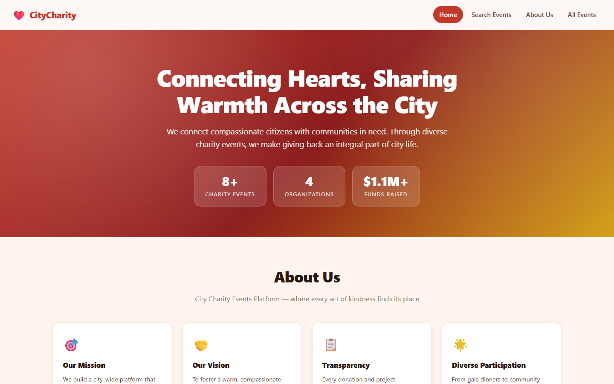
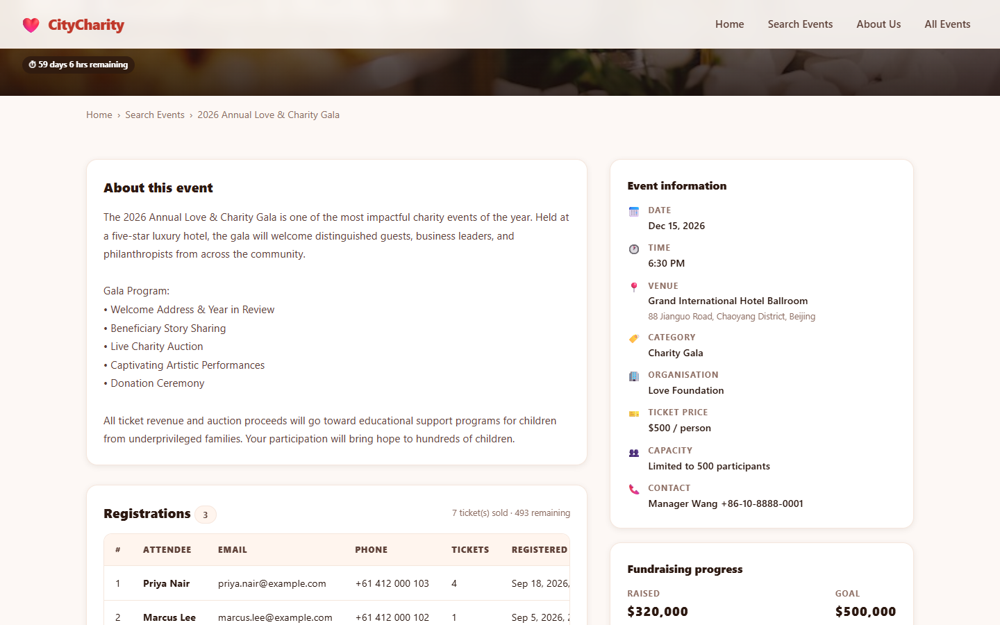
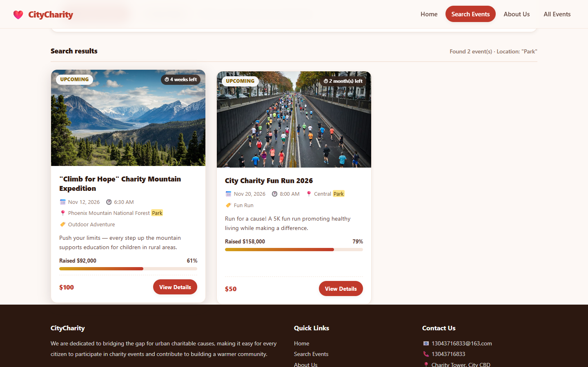
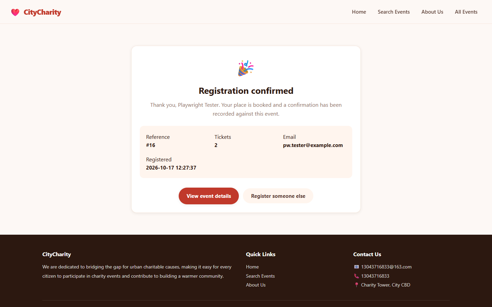
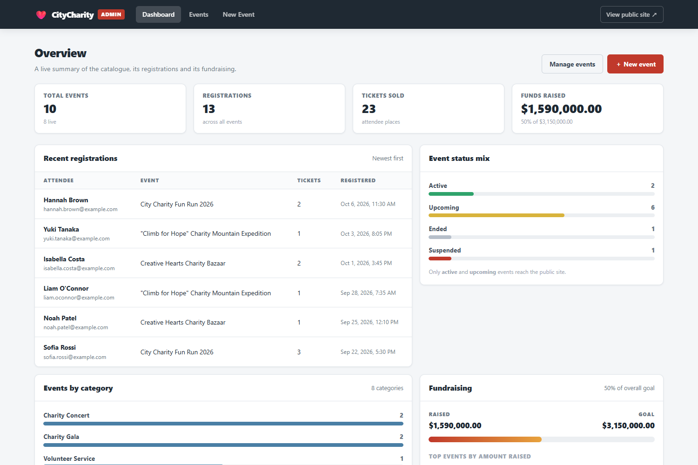
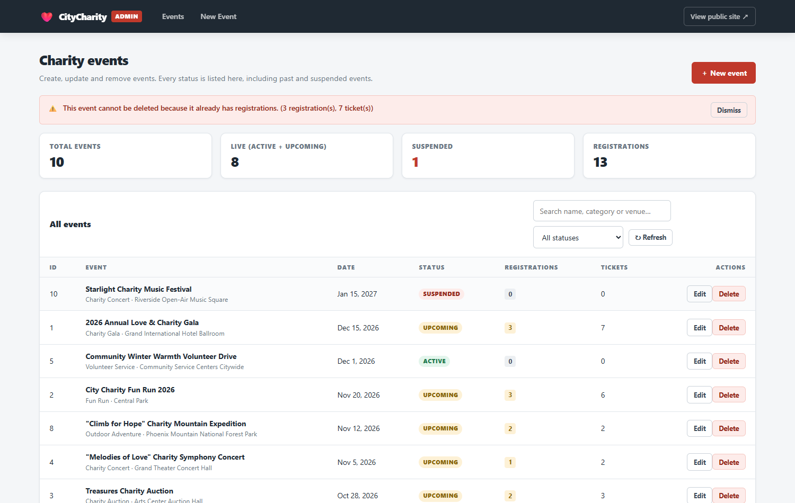

# City Charity Events Platform

**A three-tier dynamic web system — MySQL · Node.js/Express REST API · two Angular 22 applications · Open-Meteo weather integration**

[](https://angular.dev/)
[](https://www.typescriptlang.org/)
[](https://nodejs.org/)
[](https://expressjs.com/)
[](https://www.mysql.com/)
[](https://restfulapi.net/)

---

## Table of Contents

- [1. Overview](#1-overview)
- [2. Deployment](#2-deployment)
- [3. Feature Summary](#3-feature-summary)
- [4. Architecture](#4-architecture)
- [5. Technology Stack](#5-technology-stack)
- [6. Database Design](#6-database-design)
- [7. API Reference](#7-api-reference)
- [8. Frontend Architecture](#8-frontend-architecture)
- [9. Weather Integration](#9-weather-integration)
- [10. Engineering Challenges](#10-engineering-challenges)
- [11. Getting Started](#11-getting-started)
- [12. Configuration](#12-configuration)
- [13. Deployment to cPanel](#13-deployment-to-cpanel)
- [14. Project Structure](#14-project-structure)
- [15. Manual Test Checklist](#15-manual-test-checklist)
- [16. Limitations and Roadmap](#16-limitations-and-roadmap)
- [17. Screenshots](#17-screenshots)

---

## 1. Overview

The **City Charity Events Platform** connects charitable organisations with the public and gives staff the tools to manage the catalogue behind it. It is delivered as **three independently deployable applications** sharing one REST contract and one relational database:

| Application | Stack | Dev port | Responsibility |
|---|---|---|---|
| **`clientside/`** — public website | Angular 22 + TypeScript | 4200 | Browse, search, inspect and register for events |
| **`adminside/`** — staff console | Angular 22 + TypeScript | 4300 | Full C.R.U.D. over events, registration oversight |
| **`api/`** — REST service | Node.js + Express + MySQL | 3000 | Data access, business rules, weather proxy |

Every figure, list and confirmation on screen is retrieved from MySQL through the API. Nothing is hard-coded, and the two front ends contain no database access of their own.

---

## 2. Deployment

| Application | URL |
|---|---|
| Public website | https://24832834.it.scu.edu.au/ |
| Admin console | https://24832834.it.scu.edu.au/admin/ |
| REST API | https://24832834.it.scu.edu.au/api |
| Health probe | https://24832834.it.scu.edu.au/api/health |

All three run under one cPanel account: the API is a Node.js application whose base URI is `/api`, and the two Angular builds are uploaded as static files to `public_html` and `public_html/admin`. See [Section 13](#13-deployment-to-cpanel).

---

## 3. Feature Summary

### Public website

| Area | Capability |
|---|---|
| Home | Live event grid with status badges, countdowns and fundraising progress; headline statistics computed from the API |
| Search | Freely combinable filters: date, location (fuzzy), category, free-only; matched term highlighted; explicit empty state |
| Event detail | Full record, organiser profile, capacity and fundraising progress, **registration list**, seven-day venue forecast |
| Registration | Dedicated page, validated reactive form, ticket quantity, confirmation receipt, capacity and duplicate checks |

### Admin console

| Area | Capability |
|---|---|
| Dashboard | Headline figures, status and category mix, latest registrations, fundraising leaderboard |
| List | Every event regardless of status, with registration and ticket counts; seven sortable columns; independent text/status/category filters; one-click reset |
| Create | Validated form covering all required fields, posting to `POST /api/events` |
| Edit | Same form plus that event's registrations, saving through `PUT /api/events/:id` |
| Delete | Blocked with **HTTP 409** when registrations exist; the dialog renders the server's counts verbatim |
| Suspend / reinstate | Single control that immediately publishes or hides an event |
| CSV export | Exports exactly the rows currently on screen, respecting active filters |
| Navigation | Persistent header menu on every page, accurate active state, shortcut to the public site |
| Guard | Route guard refuses to discard a half-completed form |

### API

Full C.R.U.D. over events, registration creation and listing, organisation lookup, and a translated weather proxy — with uniform response envelopes and deliberate HTTP status codes.

---

## 4. Architecture

```
┌──────────────────────────┐        ┌──────────────────────────┐
│  clientside/  :4200      │        │  adminside/   :4300      │
│  Angular 22 + TypeScript │        │  Angular 22 + TypeScript │
│  home · search · detail  │        │  dashboard · list · form │
│  registration · weather  │        │  delete · registrations  │
└────────────┬─────────────┘        └────────────┬─────────────┘
             │  HttpClient (typed)               │
             │  /api proxied in dev              │
             └───────────────┬───────────────────┘
                             │  HTTP / JSON
             ┌───────────────▼───────────────────────────────┐
             │            api/  :3000  (Express)             │
             │  cors · json · routes                         │
             │  ├── /api/events          read + CRUD         │
             │  ├── /api/registrations   create + list       │
             │  ├── /api/organizations   read                │
             │  └── /api/weather         Open-Meteo proxy    │
             └───────────────┬───────────────────────────────┘
                             │  mysql2 pool (10, keep-alive)
             ┌───────────────▼───────────────────────────────┐
             │        MySQL 8  ·  charityevents_db           │
             │  organizations ─┐                             │
             │                 ├── events ──> categories     │
             │  registrations ─┘  (FKs, ENUM, indexes)       │
             └───────────────────────────────────────────────┘
                             │
                    ┌────────▼─────────┐
                    │  Open-Meteo API  │  (server-to-server)
                    └──────────────────┘
```

**Why two front ends rather than one SPA with an `/admin` section?** The public site and the staff console are separate Angular projects with separate bundles, design systems and deployment targets; they share only the REST contract and the TypeScript domain models. The boundary is enforced by build topology, not by conditional rendering — the admin bundle never ships public-site code, and the public bundle contains no concept of delete or update at all.

**Request lifecycle — registering for an event**

1. `/events/1` → `EventDetail` reads the route parameter through `withComponentInputBinding()`
2. `EventService.getEventById(1)` → `GET /api/events/1`
3. The API runs the event query and a second query for registrations ordered `registration_date DESC`
4. The API computes `tickets_sold`, `tickets_remaining` and `progress_percentage` server-side
5. Angular renders the page and passes `latitude`/`longitude` to `WeatherWidget`
6. `WeatherWidget` → `GET /api/weather` → Express proxies Open-Meteo → translated forecast
7. **Register now** → `/events/1/register`
8. The reactive form validates, then `POST /api/registrations`
9. The API validates, checks status and remaining capacity, inserts, returns **201**
10. The form is replaced by a confirmation receipt

---

## 5. Technology Stack

### Front end (both applications)

| Technology | Version | Role |
|---|---|---|
| Angular | 22.2 | Standalone components, signals, lazy routes, zoneless change detection |
| TypeScript | 6.0 | Strict typing end to end; domain models shared across services |
| Reactive Forms | Angular 22 | Validation with `Validators`, form values bridged to signals |
| `HttpClient` + `withFetch` | Angular 22 | Typed services returning `Observable<T>` |
| CSS3 | — | Two hand-built design systems (public warm, admin neutral) |

No component library, no Tailwind, no state-management library.

### Back end

| Technology | Version | Role |
|---|---|---|
| Node.js | ≥ 24.15 (CLI requirement) | Runtime |
| Express | 4.18 | Routing, middleware, JSON handling |
| mysql2 | 3.6 | Promise API, connection pool, `dateStrings` |
| cors | 2.8 | Cross-origin access for split-origin deployment |
| dotenv | 16.3 | Local `.env` loading (absent in production) |

### Data and external services

| Technology | Role |
|---|---|
| MySQL 8.x | InnoDB, `utf8mb4`, foreign keys with intentional actions, `ENUM`, `CHECK`, `UNIQUE`, indexes |
| Open-Meteo | Public forecast API, consumed server-side only |

---

## 6. Database Design

Four tables in **third normal form**, with `events` as the central fact table and `registrations` as the transactional detail table.

```
┌────────────────────┐        ┌─────────────────────┐
│   organizations    │        │     categories      │
├────────────────────┤        ├─────────────────────┤
│ org_id        PK   │        │ category_id    PK   │
│ org_name           │        │ category_name       │
│ mission_statement  │        │ category_description│
│ description        │        │ icon_class          │
│ contact_*          │        └──────────┬──────────┘
│ website_url        │                   │ ON DELETE RESTRICT
└─────────┬──────────┘                   │
          │ ON DELETE SET NULL           │
     ┌────▼──────────────────────────────▼──────┐
     │                 events                    │
     ├───────────────────────────────────────────┤
     │ event_id            PK                    │
     │ event_name · short_description            │
     │ full_description                          │
     │ category_id         FK → categories       │
     │ org_id              FK → organizations    │
     │ event_date · event_time                   │
     │ location · address                        │
     │ latitude · longitude    ← weather         │
     │ image_url                                 │
     │ ticket_price · goal_amount · current_amount│
     │ status ENUM(upcoming|active|past|suspended)│
     │ max_participants · organizer_contact       │
     │ created_at · updated_at                    │
     │ INDEX (status) (event_date) (category_id)  │
     └───────────────────┬───────────────────────┘
                         │ ON DELETE RESTRICT
     ┌───────────────────▼───────────────────────┐
     │              registrations                 │
     ├────────────────────────────────────────────┤
     │ registration_id      PK                    │
     │ event_id             FK → events           │
     │ attendee_name                              │
     │ attendee_email                             │
     │ attendee_phone                             │
     │ tickets_purchased    CHECK > 0             │
     │ registration_date    DEFAULT CURRENT_TIMESTAMP │
     │ special_requests                           │
     │ UNIQUE (event_id, attendee_email)          │
     │ INDEX (event_id) (registration_date)       │
     └────────────────────────────────────────────┘
```

### Constraint rationale

| Decision | Justification |
|---|---|
| 3NF normalisation | An organisation's contact details exist in exactly one row — no update anomalies |
| `ENUM` for `status` | The lifecycle vocabulary is enforced by the database; invalid states are unrepresentable |
| `DECIMAL(12,2)` for money | Exact decimal arithmetic; floating point would corrupt fundraising totals |
| `UNIQUE (event_id, attendee_email)` | Implements "one registration per person per event" as a hard guarantee, not a hope |
| `CHECK (tickets_purchased > 0)` | Rejects nonsensical quantities beneath the API layer |
| `ON DELETE RESTRICT` on registrations | Protects attendee records; makes the 409 rule structural |
| `ON DELETE SET NULL` on organisations | An organisation may leave; its events survive unassigned |
| Indexes on `status`, `event_date`, `category_id` | Exactly the columns used by filters and sort order |
| `latitude` / `longitude` | Required by Open-Meteo to produce a venue forecast |

**Seed dataset:** 4 organisations · 8 categories · 10 events · **13 registrations** across 6 events. Events 5, 7, 9 and 10 deliberately have **no** registrations so the delete flow can be demonstrated both blocked (409) and successful.

The complete schema **and** data live in one importable file: `database/charityevents_db.sql`.

---

## 7. API Reference

Base URL (development): `http://localhost:3000/api`
Base URL (deployed): `https://24832834.it.scu.edu.au/api`

### Events

| Method | Endpoint | Purpose |
|---|---|---|
| `GET` | `/api` | Service discovery / endpoint index |
| `GET` | `/api/health` | Database health probe |
| `GET` | `/api/events` | Upcoming + active events (public home) |
| `GET` | `/api/events/search` | Combinable filtering (public search) |
| `GET` | `/api/events/categories/list` | Categories with live event counts |
| `GET` | `/api/events/admin/all` | **Every** event, all statuses, with registration counts |
| `GET` | `/api/events/:id` | Full detail **including its registration list** |
| `POST` | `/api/events` | Create an event |
| `PUT` | `/api/events/:id` | Update an event (full or partial payload) |
| `DELETE` | `/api/events/:id` | Delete — **409 if registrations exist** |

> Route order matters: `/admin/all`, `/search` and `/categories/list` are declared before `/:id`, otherwise Express would read those words as event identifiers.

### Registrations, organisations, weather

| Method | Endpoint | Purpose |
|---|---|---|
| `GET` | `/api/registrations?eventId=3` | List registrations, optionally scoped to one event |
| `POST` | `/api/registrations` | Create a registration (ticket purchase) |
| `GET` | `/api/organizations` | Organisations for the admin dropdown |
| `GET` | `/api/weather?lat=&lon=&timezone=` | Translated Open-Meteo forecast |
| `GET` | `/api/weather/codes` | WMO code → description/icon legend |

### Search parameters

| Param | Type | Behaviour |
|---|---|---|
| `date` | `YYYY-MM-DD` | Exact date match |
| `location` | string | **Fuzzy** — `LIKE %…%` against both `location` and `address` |
| `category` | int | Exact category id |
| `freeOnly` | `1` | Only `ticket_price = 0` or `NULL` |

All optional and freely combinable.

### Status codes

| Code | Meaning |
|---|---|
| `200` | Success |
| `201` | Resource created |
| `400` | Validation failure (with an `errors[]` array) |
| `404` | Unknown event |
| `409` | Business rule conflict — duplicate registration, full capacity, or event has registrations |
| `500` | Unexpected server fault |
| `502` / `504` | Upstream weather service failure / timeout |

### Response envelope

```json
{ "success": true, "count": 3, "data": [ ... ] }
{ "success": false, "message": "Validation failed", "errors": ["Email is required"] }
```

### Implementation notes

**Search is assembled, not concatenated.** One statement is built at run time while every user value stays in a bound parameter array:

```js
if (date)     { sql += ' AND e.event_date = ?';            params.push(date); }
if (location) { sql += ' AND (e.location LIKE ? OR e.address LIKE ?)';
                params.push(`%${location}%`, `%${location}%`); }
if (category) { sql += ' AND c.category_id = ?';           params.push(parseInt(category, 10)); }
if (freeOnly) { sql += ' AND (e.ticket_price = 0 OR e.ticket_price IS NULL)'; }

const [rows] = await pool.execute(sql, params);   // prepared statement
```

**Deletion enforces integrity twice.** The API counts registrations and tickets before deleting and refuses with 409, returning both figures. The foreign key is `ON DELETE RESTRICT`, so MySQL refuses too if a registration arrived in between — that error is translated into the same 409.

**Detail pages cost two round trips,** not one query per row: one joined event query plus one registration query, with aggregates computed server-side so both front ends show identical numbers.

---

## 8. Frontend Architecture

Both applications follow the same shape:

```
src/app/
├── app.ts / app.html            # shell: navbar + router-outlet + footer
├── app.config.ts                # providers: router, HttpClient, scrolling
├── app.routes.ts                # lazy loadComponent per screen
├── core/
│   ├── config/api.config.ts     # single API base + public site URL
│   ├── models/*.ts              # typed contract with the API
│   └── services/*.ts            # HTTP + error normalisation
├── shared/                      # reusable presentation
└── pages/                       # one folder per screen
```

**Angular 22 features used deliberately**

| Feature | Where it matters |
|---|---|
| **Signals** (`signal`, `computed`, `input`) | Every component holds state as signals, so zoneless change detection works without `markForCheck` |
| **Standalone components** | No `NgModule` anywhere; each component declares exactly what it imports |
| **Lazy `loadComponent`** | Only the shell and the current screen are downloaded |
| **`withComponentInputBinding()`** | `/events/:id` binds straight into `readonly id = input.required<string>()` |
| **Reactive Forms** | Validation on registration and admin forms, with live value signals |
| **Typed HTTP services** | Components never touch `HttpClient`; they receive `Observable<CharityEvent>` |
| **`takeUntilDestroyed`** | Weather subscriptions cannot outlive their component |

Error handling is centralised per application in `extractApiError()`, which prefers field-level `errors[]`, then `message`, and falls back to a network hint when `status === 0`.

**Public routes**

| Route | Screen |
|---|---|
| `/` | Home — hero, live statistics, event grid |
| `/search` | Search — four combinable filters |
| `/events/:id` | Detail — record, organiser, progress, registrations, weather |
| `/events/:id/register` | Registration — validated form + confirmation |

**Admin routes**

| Route | Screen |
|---|---|
| `/` | Dashboard — KPIs, status and category mix, recent registrations, fundraising |
| `/events` | Event list — stats, search, filters, sorting, CSV, suspend, edit/delete |
| `/events/new` | Create form |
| `/events/:id/edit` | Edit form + that event's registrations |

---

## 9. Weather Integration

```
Angular WeatherWidget
        │  GET /api/weather?lat=39.9087&lon=116.4576&timezone=Asia/Shanghai
        ▼
Express /api/weather
        │  · validates lat/lon ranges
        │  · 10-minute in-memory cache
        │  · 8-second AbortController timeout
        │  · translates WMO codes → description + icon + group
        ▼
https://api.open-meteo.com/v1/forecast
```

The browser never calls Open-Meteo directly, which means:

1. **No third-party CORS dependency** — our origin is the only one that matters
2. **One translation table** — both applications render identical wording for code `95`
3. **Caching** — ten page views do not become ten upstream requests
4. **Timeout control** — a slow third party cannot hang the UI indefinitely
5. **Swap-friendly** — replacing the provider changes one file, not every component

The widget degrades gracefully: no coordinates → neutral notice; upstream failure → the error text; during load → a placeholder.

---

## 10. Engineering Challenges

**A cross-tier timezone defect.** Every event rendered one day early and countdowns printed `NaN month(s) left`, with no console error. `mysql2` was converting a MySQL `DATE` into a JavaScript `Date` at local midnight, which `JSON.stringify` serialised as a UTC instant one day behind. Fixed at the source (`dateStrings: true`) and defended on the client (slice to 10 characters, guard `isNaN`).

**Duplicate registrations under concurrency.** A read-then-insert check races: two requests can both read "not registered". The guarantee lives in the schema as `UNIQUE (event_id, attendee_email)`; the API still pre-checks for a friendly message and translates `ER_DUP_ENTRY` into 409.

**Deleting an event without destroying attendance history.** `ON DELETE CASCADE` would silently erase registrations. `ON DELETE RESTRICT` plus an explicit pre-flight count keeps the history intact and turns the refusal into an informative response.

**Two SPAs over one API.** Each Angular project ships a `proxy.conf.json` mapping `/api` → `:3000`, so application code uses the relative base `/api` and knows no hostnames; the API enables `cors()` as a fallback for split-origin deployment.

**N+1 queries on the detail page.** One `JOIN`ed event query plus one registration query — a constant two round trips — with aggregates computed once on the server.

**Zoneless change detection with reactive forms.** All mutable state is a signal; derived values are `computed()`; form values that drive the UI are bridged with `toSignal(form.valueChanges)`.

---

## 11. Getting Started

### Prerequisites

- **Node.js ≥ 24.15** (Angular 22 CLI requires v24.15.0 / v22.22.3 / v26.0.0)
- **MySQL 8.x** running locally
- npm 11+

### 1 · Create and seed the database

```bash
mysql -u root -p < database/charityevents_db.sql
```

This creates `charityevents_db` with all four tables and seeds 10 events / 13 registrations. The file is BOM-free and safe to re-run.

### 2 · Start the API

```bash
cd api
npm install
cp .env.example .env     # optional locally: defaults already match root / empty password
node server.js
```

Expected output:

```
MySQL database connected successfully!
  Events: 10 | Categories: 8
  API:       http://localhost:3000/api
```

### 3 · Start the public website

```bash
cd clientside
npm install
npm start          # ng serve → http://localhost:4200
```

### 4 · Start the admin console

```bash
cd adminside
npm install
npm start          # ng serve → http://localhost:4300
```

| Service | URL |
|---|---|
| Public website | http://localhost:4200 |
| Admin console | http://localhost:4300 |
| API | http://localhost:3000/api |

### Optional — running without MySQL

```bash
cd api && npm install --no-save better-sqlite3 && node db_init.js
```

`db_init.js` builds a standalone SQLite database for an offline demo. It is an optional convenience; the application itself always talks to MySQL.

---

## 12. Configuration

### Database credentials — environment variables

`api/event_db.js` reads its settings from the environment and falls back to local defaults:

| Variable | Local default | cPanel value |
|---|---|---|
| `DB_HOST` | `localhost` | `127.0.0.1` |
| `DB_PORT` | `3306` | `3306` |
| `DB_USER` | `root` | `<account>_<user>` |
| `DB_PASSWORD` | *(empty)* | the MySQL user's password |
| `DB_NAME` | `charityevents_db` | `<account>_<database>` |

Locally, put them in a git-ignored `api/.env` (template: `api/.env.example`). In production they are set in the cPanel Node.js application panel.

### Front-end API base

```ts
// clientside/src/app/core/config/api.config.ts
export const API_BASE = '/api';
```

A relative path works in development (through `proxy.conf.json`) and in production (API on the same origin). Only a split-origin deployment needs an absolute URL.

```ts
// adminside/src/app/core/config/api.config.ts
export const PUBLIC_SITE_URL = 'https://24832834.it.scu.edu.au';
```

Used by the "view public site" shortcut and the per-row link to the public page.

---

## 13. Deployment to cPanel

Everything is served from one account, so `API_BASE` stays relative and there is no CORS to configure.

| URL | Serves | Uploaded from |
|---|---|---|
| `/` | public website | `dist/clientside/browser` |
| `/admin/` | admin console | `dist/adminside/browser` (built with `--base-href /admin/`) |
| `/api/...` | REST API | `api/` through *Setup Node.js App* |

### Build

```bash
cd clientside && npm run build                                  # → dist/clientside/browser
cd ../adminside && npm run build -- --base-href /admin/          # → dist/adminside/browser
```

### Database

Create the database and a user in *MySQL Databases*, grant ALL PRIVILEGES, then import **`database/charityevents_cpanel.sql`** through phpMyAdmin. Use that copy, not the original: a hosting user has no `CREATE DATABASE` privilege, so the `DROP DATABASE` / `CREATE DATABASE` statements abort the import.

### API

1. Upload `api/` (without `node_modules/` or `*.db`) to a directory **outside** `public_html`, e.g. `~/charity_api`.
2. *Setup Node.js App* → Create: application root `charity_api`, application URL `api`, startup file `server.js`, mode Production.
3. Add `DB_HOST`, `DB_PORT`, `DB_USER`, `DB_PASSWORD`, `DB_NAME` as environment variables — no credential is committed to Git.
4. Run *NPM Install*, then *Restart*; check `/api/health` for `{"success":true,"database":"connected"}`.

> `better-sqlite3` is not a runtime dependency, so nothing native has to compile on the host.

### Front ends

Upload the **contents** of each `dist/*/browser` folder to `public_html/` and `public_html/admin/`.

### Rewrite rules

Copy `deploy/public_html/.htaccess` to `public_html/.htaccess` and `deploy/public_html/admin/.htaccess` to `public_html/admin/.htaccess`. Without them a refresh on `/events/3` or `/admin/events/3/edit` returns 404, and `/api` requests would be swallowed by the SPA rewrite. The root file also disables directory listing and marks `index.html` as non-cacheable.

---

## 14. Project Structure

```
城市慈善活动管理动态网站/
├── api/                          # Express REST service
│   ├── server.js                 # entry point, route mounting
│   ├── event_db.js               # mysql2 pool, env-based config
│   ├── db_init.js                # optional offline SQLite demo
│   ├── .env.example
│   └── routes/
│       ├── events.js             # read + CRUD, 409 integrity rule
│       ├── registrations.js      # create + list
│       ├── organizations.js      # lookup
│       └── weather.js            # Open-Meteo proxy, cache, WMO map
├── clientside/                   # public Angular application
│   └── src/app/{core,pages,shared}
├── adminside/                    # admin Angular application
│   └── src/app/{core,pages,shared}
├── database/
│   ├── charityevents_db.sql      # full schema + seed data
│   └── charityevents_cpanel.sql  # import-ready copy for shared hosting
├── deploy/
│   ├── out/                      # build packages for upload
│   └── public_html/              # .htaccess files (root + /admin)
├── docs/screenshots/a3/          # documentation captures
└── archive/a2-vanilla-client/    # previous iteration, kept for reference
```

---

## 15. Manual Test Checklist

| Check | Expected |
|---|---|
| `GET /api/health` | `{"success":true,"database":"connected"}` |
| `GET /api/events` | Only `upcoming` / `active` events |
| `GET /api/events/search?location=…` | Fuzzy match on venue and address |
| `GET /api/events/1` | Event plus registrations, newest first |
| `POST /api/registrations` (valid) | 201 with the created record |
| Same email, same event again | 409, no duplicate row |
| `DELETE` an event with registrations | 409 with `registration_count` and `tickets_sold` |
| `DELETE` an event without registrations | 200, row removed |
| Refresh `/events/3` | Page renders (SPA fallback) |
| Refresh `/admin/events/3/edit` | Page renders |
| `GET /api/weather` with valid coordinates | Seven-day forecast |

---

## 16. Limitations and Roadmap

- **No admin authentication.** Out of scope here; it is the first change production use would demand (session or JWT, role-based access).
- **No pagination** on the admin list — fine at ten events, a problem at a thousand.
- **Capacity is enforced in the API**, because it is a cross-row aggregate a `CHECK` cannot express; a transactional stored procedure would make it atomic under heavy concurrency.
- **Fixed currency and time zone.**
- **Per-process weather cache** — a second instance would double upstream traffic.

---

## 17. Screenshots

| Public home | Event detail with registrations |
|---|---|
|  |  |

| Search with filters | Registration confirmed |
|---|---|
|  |  |

| Admin dashboard | Delete blocked by the integrity rule |
|---|---|
|  |  |

---

## 中文速览

- **结构**：`clientside/`（公众站，Angular 22）、`adminside/`（后台，Angular 22）、`api/`（Node.js + Express + MySQL），三者共享一套 REST 契约与一个数据库。
- **数据库**：4 张表（组织结构/类别/活动/报名），第三范式；`UNIQUE(event_id, attendee_email)` 保证每人每活动只报一次，`CHECK` 约束票数，外键 `RESTRICT` 保证有报名不可删除。
- **接口**：活动完整 C.R.U.D.、报名创建与查询、组织查询、天气代理；统一响应信封与 200/201/400/404/409/502 语义。
- **前端**：Angular 22 无 Zone + 信号、独立组件、懒加载、响应式表单；公众站四页，后台仪表盘/列表/新建/编辑。
- **部署**：cPanel 上 API 挂在 `/api`（Node.js 应用），两个静态构建分别放在 `public_html` 与 `/admin/`，由两份 `.htaccess` 完成 SPA 回退。
- **本地启动**：导入 `database/charityevents_db.sql` → `cd api && node server.js` → 两个前端各自 `npm install && npm start`。

---

## Author

**Wang Yuning** · Student ID 24832834
PROG2002 Web Development II

> Angular 22 + TypeScript · Node.js + Express · MySQL 8 · Open-Meteo
